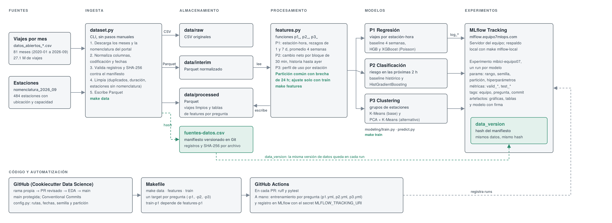
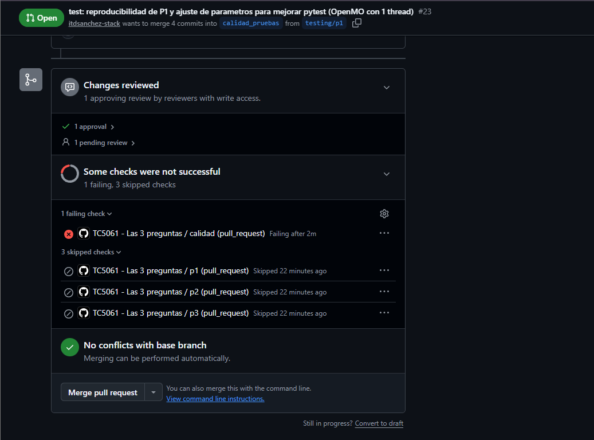
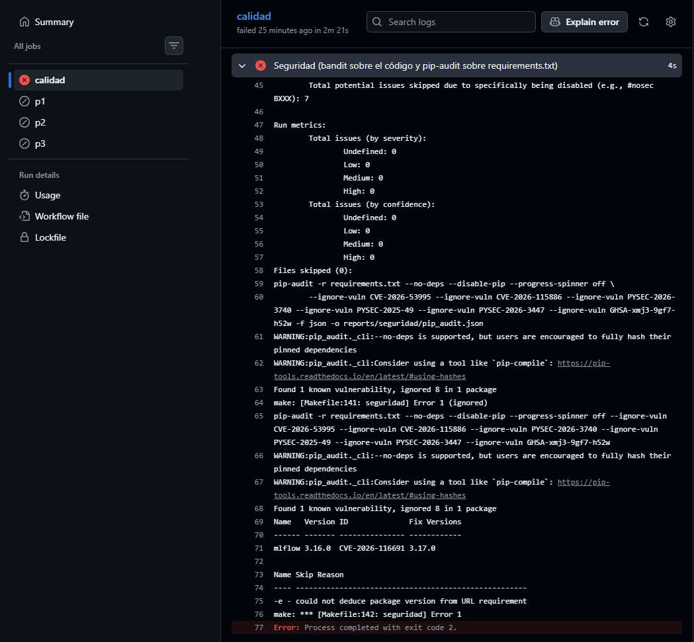
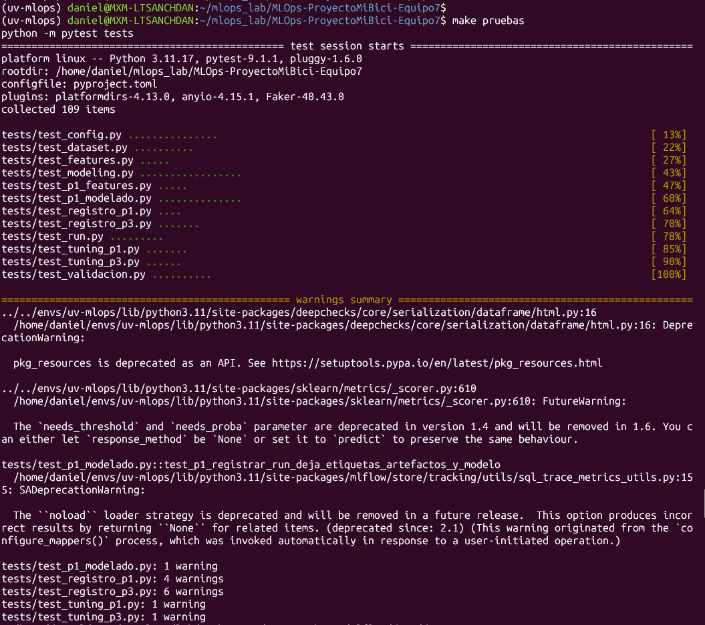
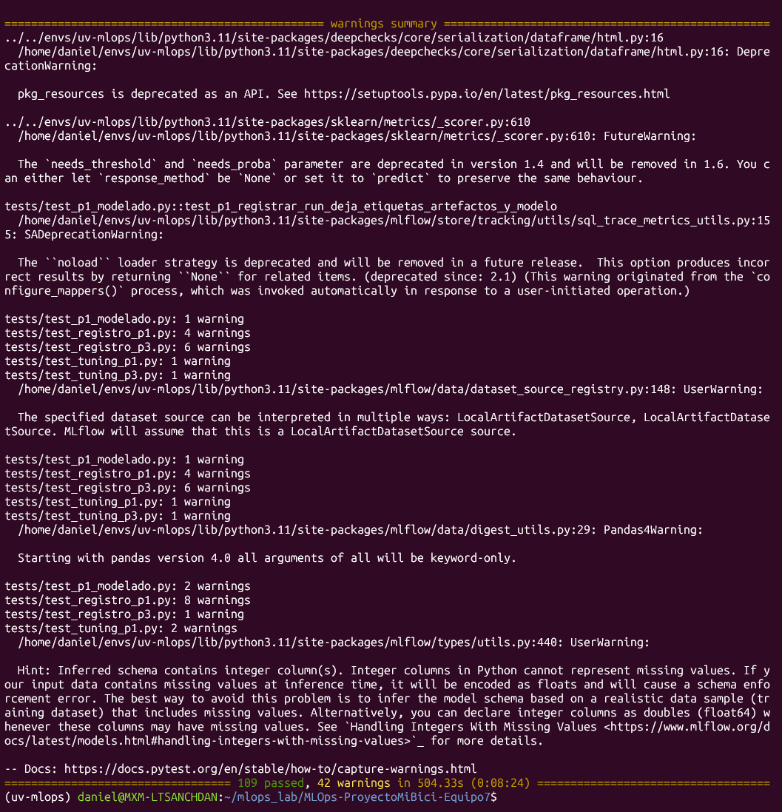
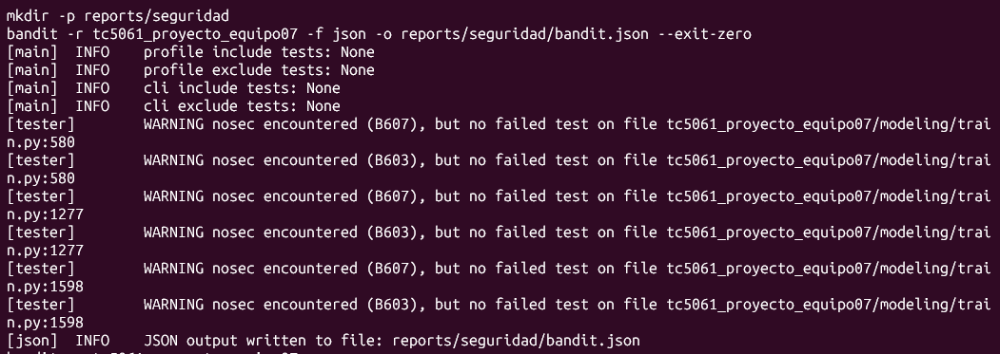
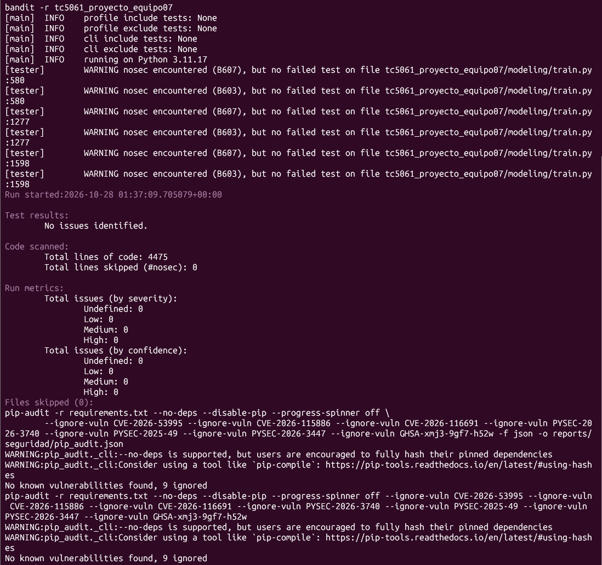

# TC5061-Proyecto-Equipo07

<a target="_blank" href="https://cookiecutter-data-science.drivendata.org/">
    
</a>

Proyecto integrador de **Operaciones de Aprendizaje Automático (MLOps, TC5061)** del Equipo 7. Propone y construye una solución de Machine Learning sobre los datos abiertos de **MiBici**, el sistema de bicicleta pública del Área Metropolitana de Guadalajara.

## Instalación

Requiere Python 3.11 y [uv](https://docs.astral.sh/uv/).

```bash
git clone https://github.com/sanchezdavilaluisarturo/TC5061-Proyecto-Equipo07.git
cd TC5061-Proyecto-Equipo07
uv venv --python 3.11 .venv
source .venv/bin/activate
make requirements        # uv pip install -r requirements.txt (incluye el paquete con -e .)
cp .env.example .env     # URL de MLflow; el .env no se versiona
```

El `.env` apunta al servidor MLflow del equipo (https://mlflow.equipo7mlops.com), que no pide credenciales: con él se pueden registrar y consultar los runs. Si no responde, `make mlflow-local` levanta un MLflow local de respaldo (SQLite + `mlartifacts/`) y en el `.env` se usa `MLFLOW_TRACKING_URI=http://127.0.0.1:5000`.

## Ejecución

```bash
# Datos: descarga, normaliza, valida contra el manifiesto y limpia
make data

# Features de P1, P2 y P3 (o una sola pregunta: make features-p1, features-p2, features-p3)
make features

# Entrenamiento y evaluación de P1, P2 y P3, sin registrar en MLflow (o make train-p1, train-p2, train-p3)
make train

# Mismo entrenamiento, registrando los runs en MLflow (una variable por pregunta)
P1_REGISTRAR_MLFLOW=true P2_REGISTRAR_MLFLOW=true P3_REGISTRAR_MLFLOW=true make train
```

`make help` lista todos los comandos. `train-p1` depende de `features-p1`, así que siempre entrena con las features al día.

Para reproducir las corridas con `mlflow run` (entorno propio y runs registrados), ver [Ejecución con MLflow Project](#ejecución-con-mlflow-project).

### Comandos por pregunta

Cada etapa es un comando del módulo `tc5061_proyecto_equipo07`; los notebooks solo exploran y documentan los hallazgos (se corren desde `notebooks/`).

| Etapa | P1 | P2 | P3 | Qué deja listo |
|---|---|---|---|---|
| Datos (común) | `make data` | `make data` | `make data` | CSV en `data/raw/`, Parquet normalizado en `data/interim/` y viajes limpios en `data/processed/` |
| Features | `make features-p1` | `make features-p2` | `make features-p3` | La tabla de cada pregunta en `data/processed/`, con la partición común |
| Entrenamiento y evaluación | `make train-p1` | `make train-p2` | `make train-p3` | Métricas, figuras en `reports/figures/pN_*` y, si se pide, runs en MLflow |
| Workflow de GitHub Actions | `p1.yml` | `p2.yml` | `p3.yml` | Lo mismo en un runner de GitHub |

**Convención:** cada pregunta prefija lo que agrega al módulo (`p1_`, `p2_`, `p3_`; por ejemplo, `p3_perfil_de_estaciones`) y el código de una pregunta no depende del de otra. Lo común usa nombres genéricos (`FRONTERA_VALID`, `FRONTERA_TEST`, `BRECHA_HORAS`).

**Variables de entorno.** El mismo comando corre en la terminal, en los notebooks y en GitHub Actions; cada parámetro tiene también su opción de línea de comandos:

| Variable | Qué controla | Por defecto |
|---|---|---|
| `MLFLOW_TRACKING_URI` | URL del servidor MLflow (en CI, el secret del repositorio `MLFLOW_TRACKING_URI`) | `.env` |
| `P1_REGISTRAR_MLFLOW`, `P2_REGISTRAR_MLFLOW`, `P3_REGISTRAR_MLFLOW` | Escribir en MLflow los runs de cada pregunta | `false` |
| `MLFLOW_RUN_NAME` | P2 y P3: prefijo del nombre de los runs (en CI lo fija el workflow). P1 usa nombres fijos | P2: `baseline-historico`, `hgb`, `xgb` y `xgb-optuna`; P3: `baseline` y `pca_kmeans` |
| `P2_PESO_HISTORICO`, `P2_MIN_SAMPLES_LEAF` | Parámetros del modelo de P2 | `20`, `1000` |
| `P3_REGISTRAR_DE_NUEVO` | P3: crear un run nuevo aunque ya exista uno terminado con ese nombre | `false` |
| `P3_EXIGIR_ACEPTACION` | P3: salir con error si el modelo alternativo no cumple los criterios de aceptación | `false` |
| `P3_EXPERIMENTO` | P3: experimento de MLflow | `mibici-equipo07` (el de `config.py`) |
| `P3_SEMILLA`, `P3_K_MINIMO`, `P3_K_MAXIMO`, `P3_MIN_SALIDAS_TRAIN`, `P3_MIN_SALIDAS_VALID`, `P3_COMPONENTES`, `P3_SEMILLAS_BUSQUEDA` | Parámetros del modelo de P3 | `42`, `2`, `10`, `1000`, `300`, `3,4,5,6,8,10`, `5` |

**Pruebas y chequeos:** `make pruebas` y `make seguridad`; ver [Pruebas y chequeos de calidad](#pruebas-y-chequeos-de-calidad).

**GitHub Actions:** `TC5061-Proyecto-Equipo07.yml` corre el job de calidad (`ruff`, `pytest` y `make seguridad`) en cada PR que toca el módulo, las pruebas, el Makefile o los workflows. A mano (*Run workflow*) corre la calidad y luego la acción de cada pregunta (`p1.yml`, `p2.yml` y `p3.yml`), que también se puede correr sola. Las tres descargan los datos con caché por el hash del manifiesto, entrenan con su target de `make` y solo registran en MLflow si se marca `registrar`.

**MLflow del equipo:** https://mlflow.equipo7mlops.com/ (la URL se define en `MLFLOW_TRACKING_URI`). Los runs de la entrega están en el experimento `mibici-equipo07`: `p1-baseline-promedio-4sem`, `p1-hgb-poisson` y `p1-xgb-poisson` (P1), `p2-baseline-historico` y `p2-hgb` (P2), y `p3-baseline` y `p3-pca_kmeans` (P3). En la Fase 2, P1 agrega las búsquedas `p1-xgb-optuna-busqueda` y `p1-hgb-optuna-busqueda` (con sus runs `trial_N`), los candidatos `p1-xgb-optuna` y `p1-hgb-optuna` y el modelo registrado `mibici-equipo07-p1-demanda` (alias `champion`). En la Fase 2, P2 agrega la búsqueda `p2_xgb_optuna_busqueda` (con sus runs `trial_N`), los candidatos `p2-xgb` y `p2-xgb-optuna`, y el modelo registrado `mibici-equipo07-p2-riesgo` (alias `champion` y `challenger`).

## Ejecución con MLflow Project

Las corridas de la entrega se lanzan con `mlflow run` desde el `MLproject` de la raíz, no desde un notebook. MLflow construye un entorno aislado con las versiones fijas de `requirements.txt` (`python_env.yaml`), ejecuta el punto de entrada pedido y registra el run. Rutas, fechas y semillas no se repiten en la línea de comandos: salen de `tc5061_proyecto_equipo07/config.py`.

### Requisitos

| Requisito | Para qué | Cómo |
|---|---|---|
| CLI de `mlflow` | Lanzar `mlflow run` | Viene en `requirements.txt` (con el `.venv` activo) |
| [pyenv](https://github.com/pyenv/pyenv) | Que MLflow instale Python 3.11 en su entorno aislado | macOS: `brew install pyenv`. WSL/Ubuntu: ver el bloque siguiente |
| `MLFLOW_TRACKING_URI` | Dónde se registran los runs | Ver el paso 1 |

En WSL/Ubuntu, pyenv se instala con su script oficial, después de las dependencias con las que se compila Python:

```bash
sudo apt update && sudo apt install -y build-essential libssl-dev zlib1g-dev libbz2-dev \
  libreadline-dev libsqlite3-dev libffi-dev liblzma-dev libncurses-dev tk-dev xz-utils
curl https://pyenv.run | bash
# Solo estas dos líneas en el ~/.bashrc (no las de `pyenv init` que sugiere el instalador)
echo 'export PYENV_ROOT="$HOME/.pyenv"' >> ~/.bashrc
echo 'export PATH="$PYENV_ROOT/bin:$PATH"' >> ~/.bashrc
# Abrir una terminal nueva y verificar
pyenv --version
which -a python   # el primero debe seguir siendo el del entorno activo
```

`mlflow run` solo necesita el comando `pyenv`. Las líneas `eval "$(pyenv init ...)"` que imprime el instalador ponen los *shims* de pyenv antes que el entorno activo en el `PATH`, y entonces `python` deja de ser el del `.venv` (por ejemplo, `pytest` aparece como no instalado).

Si no se quiere instalar pyenv, se puede usar el `.venv` del proyecto con `--env-manager local` (ver [Entorno de ejecución](#entorno-de-ejecución)).

### Paso a paso

**1. Elegir el servidor de MLflow y exportar su URI.** El servidor del equipo es **https://mlflow.equipo7mlops.com/** (no pide credenciales) y es donde deben quedar los runs de la entrega. `mlflow run` lee la variable del shell, no del `.env`, así que se exporta en la terminal donde se lanzan los runs.

```bash
# Servidor del equipo (el de la entrega)
export MLFLOW_TRACKING_URI=https://mlflow.equipo7mlops.com
```

Si el servidor del equipo no responde, se puede usar uno local de respaldo. En otra terminal se levanta y se deja corriendo; en la terminal de los runs se apunta a él:

```bash
# Terminal 1: servidor local con base de datos
mlflow server --backend-store-uri sqlite:///mlflow.db --artifacts-destination ./mlartifacts --port 5000

# Terminal 2: la terminal donde se lanzan los runs
export MLFLOW_TRACKING_URI=http://127.0.0.1:5000
```

`--artifacts-destination` es necesario en el servidor local: sin él, MLflow 3 no puede subir los artefactos (figuras y modelo).

**2. Preparar datos y features** (`ingest`). Descarga, normaliza y limpia los viajes y construye las features de P1, P2 y P3. Es el equivalente de `make data` más `make features`, y se corre una vez por clon. Si `data/processed/` ya tiene las tablas de la pregunta que se va a entrenar, se puede omitir. Para la entrega, desde un clon limpio, se corre con todo:

```bash
mlflow run . -e ingest --experiment-name mibici-equipo07
```

**3. Entrenar y registrar** (`train`). Cada comando entrena el modelo elegido y deja sus runs en el experimento `mibici-equipo07` del servidor al que apunta `MLFLOW_TRACKING_URI`.

```bash
# P1: un modelo con hiperparámetros
mlflow run . -e train -P question=p1 -P model=xgb -P n_estimators=300 --experiment-name mibici-equipo07

# P1: los demás modelos (baseline, hgb)
mlflow run . -e train -P question=p1 -P model=baseline --experiment-name mibici-equipo07
mlflow run . -e train -P question=p1 -P model=hgb --experiment-name mibici-equipo07

# P2: riesgo de estación
mlflow run . -e train -P question=p2 -P model=baseline --experiment-name mibici-equipo07
mlflow run . -e train -P question=p2 -P model=hgb --experiment-name mibici-equipo07
mlflow run . -e train -P question=p2 -P model=xgb --experiment-name mibici-equipo07

# O alternativamente entrenar las 3 opciones de modelo de P2 en un solo comando:
mlflow run . -e train -P question=p2 --experiment-name mibici-equipo07

# P3: clustering de estaciones (baseline y alternativo; sin `model` corre los dos)
mlflow run . -e train -P question=p3 -P model=baseline --experiment-name mibici-equipo07
mlflow run . -e train -P question=p3 -P model=alternativo --experiment-name mibici-equipo07
```

**4. Buscar hiperparámetros** (`tune`). Corre una búsqueda con Optuna: un run padre, un run hijo por trial y, al final, el mejor trial re-entrenado como candidato (ver [Fase 2 de P1](#fase-2-búsqueda-de-hiperparámetros-selección-y-registro), [Fase 2 de P2](#fase-2) y [Búsqueda con Optuna (P3)](#búsqueda-con-optuna-p3)).

```bash
# P1
mlflow run . -e tune -P question=p1 -P model=xgb --experiment-name mibici-equipo07

# P2
mlflow run . -e tune -P question=p2 -P model=xgb --experiment-name mibici-equipo07
mlflow run . -e tune -P question=p2 -P model=xgb -P n_trials=30 -P timeout_min=120 --experiment-name mibici-equipo07

# P3 (el modelo es `alternativo`; `fraccion_train` no aplica)
mlflow run . -e tune -P question=p3 -P model=alternativo -P n_trials=60 --experiment-name mibici-equipo07
```

**5. Registrar el campeón** (`register`). Registra el modelo de un run como versión nueva en el Model Registry y le pone un alias (`champion` por defecto). El run se elige en la interfaz y se pasa su ID:

```bash
# P1
mlflow run . -e register -P question=p1 -P run_id=ID_DEL_RUN --experiment-name mibici-equipo07

# P2
mlflow run . -e register -P question=p2 -P run_id=ID_DEL_RUN --experiment-name mibici-equipo07

# P3 (ver Model Registry (P3)); con -P alias=challenger queda registrado sin reemplazar al campeón
mlflow run . -e register -P question=p3 -P run_id=ID_DEL_RUN --experiment-name mibici-equipo07
```

### Puntos de entrada

| Punto de entrada | Qué ejecuta | Parámetros |
|---|---|---|
| `ingest` | `dataset todo`, `p1-features`, `p2-features`, `p3-particionar` y `p3-features` | Ninguno: usa el rango de `config.py` |
| `train` | `modeling/run.py`, que llama al comando de `modeling/train.py` de la pregunta y siempre registra en MLflow | Ver la tabla siguiente |
| `tune` | `modeling/tuning_<question>.py`: búsqueda de hiperparámetros con Optuna y runs anidados, y deja el mejor como candidato | `question` (`p1`, `p2` o `p3`), `model` y, opcionales, `n_trials`, `timeout_min`, y `fraccion_train` (P1 y P2); vacío = `P1_BUSQUEDA`, `P2_BUSQUEDA`  o `P3_BUSQUEDA` de `config.py` |
| `register` | `modeling/registro_<question>.py`: registra el modelo de un run en el Model Registry con un alias | `question`, `run_id` y `alias` (por defecto `champion`) |

`tune` y `register` arman el módulo con el nombre de la pregunta, así que una pregunta nueva solo agrega su `tuning_pN.py` o `registro_pN.py`, sin tocar el `MLproject`.

### Parámetros de `train`

Un parámetro vacío (el valor por defecto) conserva el valor de `config.py`. `question` es el único obligatorio.

| Parámetro | Valores | Aplica a |
|---|---|---|
| `question` | `p1`, `p2`, `p3` | todos |
| `model` | P1: `baseline`, `hgb`, `xgb`. P2: `baseline`, `hgb`, `xgb`. P3: `baseline`, `alternativo`. Vacío = todos los de la pregunta | todos |
| `n_estimators` | entero (en HGB se traduce a `max_iter`) | P1 y P2 `hgb` y `xgb` |
| `learning_rate` | decimal | P1 y P2 `hgb` y `xgb` |
| `max_depth` | entero | P1 y P2 `hgb` y `xgb` |
| `min_samples_leaf` | entero | P1 y P2 `hgb` |

- Un hiperparámetro que no aplica al modelo elegido se rechaza con un error claro; no se ignora en silencio. Los hiperparámetros requieren `model`: sin él, se rechazan.
- Los candidatos con Optuna (`xgb_optuna`, `hgb_optuna`) no se entrenan con `train`: salen de `tune`.
- P3 no recibe hiperparámetros por esta vía: se ajustan con las variables `P3_*` (ver la tabla de variables de entorno).
- Los valores que se pasan quedan registrados como parámetros del run (por ejemplo `modelo_n_estimators` en `xgb` o `modelo_max_iter` en `hgb`).

### Entorno de ejecución

| Modo | Comando | Cuándo usarlo |
|---|---|---|
| Entorno aislado (por defecto) | `mlflow run . -e train ...` | Entrega y verificación desde un clon limpio. La primera vez tarda varios minutos: instala Python 3.11 y todo `requirements.txt`. Las siguientes reutilizan el entorno en `~/.mlflow/envs/` |
| Entorno activo | `source .venv/bin/activate` y `mlflow run . -e train ... --env-manager local` | Iterar rápido. Debe ser el `.venv` del proyecto (Python 3.11); no sirve el `base` de conda |

### Qué deja cada corrida

- **Runs del modelo** en el experimento `mibici-equipo07`, con parámetros, métricas, etiquetas (`equipo`, `pregunta`, `commit`; en la Fase 2, se usa `question`, `stage_of_work`, `model_family` y `fase`), artefactos y el modelo. Sus nombres son los de la sección "MLflow del equipo" más abajo.
- **Un run contenedor** del proyecto (nombre aleatorio, por ejemplo `silent-ray-926`), sin métricas: guarda los parámetros de `mlflow run`. Sale en el experimento que se pasa con `--experiment-name` (sin la opción, en `Default`).
- **Archivos regenerados** en `reports/figures/`. Están versionados, así que conviene revisar `git status` y revertir con `git checkout -- reports/figures` lo que no se quiera commitear.

### Cargar el modelo registrado

**Esquema.** Hay un modelo registrado por pregunta (`mibici-equipo07-p1-demanda`, `mibici-equipo07-p2-riesgo` y `mibici-equipo07-p3-segmentos`). Cada `register` crea una **versión** numerada nueva, que no se modifica después, y un **alias** señala qué versión se usa:

| Alias | Significado |
|---|---|
| `champion` | La versión vigente: la que debe usar quien consume el modelo |
| `challenger` | Una versión registrada que compite con la vigente sin reemplazarla (por ejemplo, el baseline de P3 o el candidato de Optuna de 30 trials de P2) |

El modelo se carga por nombre y alias, `models:/<nombre>@<alias>`; para fijar una versión exacta (auditoría o reproducir un resultado) se usa su número, `models:/<nombre>/<versión>`.

```python
import mlflow

mlflow.set_tracking_uri("https://mlflow.equipo7mlops.com")
modelo = mlflow.pyfunc.load_model("models:/mibici-equipo07-p3-segmentos@champion")
grupos = modelo.predict(modelo.input_example)  # o un DataFrame con las 44 variables por estación
```

**Por qué alias y no etapas** (`Staging`, `Production`, `Archived`):

- **Las etapas están en desuso.** MLflow las marca como obsoletas desde la versión 2.9.0 y avisa que se eliminarán en una versión mayor futura (el cliente lo advierte al usarlas, por ejemplo con `get_latest_versions`). Un esquema nuevo no debería depender de ellas.
- **Los alias no imponen un ciclo fijo.** Las etapas son un conjunto cerrado de nombres (`None`, `Staging`, `Production` y `Archived`); con alias se nombra lo que el equipo necesita (`champion` y `challenger`), y una versión puede tener más de uno.
- **Quien consume el modelo no cambia su código.** Promover una versión nueva es mover el alias, en una sola operación; la URI `models:/<nombre>@champion` sigue siendo la misma.
- **Una sola forma de resolver el modelo.** Con etapas y alias a la vez, `models:/<nombre>/Production` y `models:/<nombre>@champion` podrían apuntar a versiones distintas. Aquí no se usan etapas: esa URI falla porque no hay versiones en la etapa.

**Verificación** (24 de octubre de 2026, desde un directorio ajeno al repositorio, con MLflow 3.16.0 y scikit-learn 1.5.2, contra el servidor del equipo; `register` repite esta comprobación al terminar con `p1_verificar`, `p2_verificar` y `p3_verificar`):

| URI | Resultado |
|---|---|
| `models:/mibici-equipo07-p3-segmentos@champion` | Carga la versión 4 y asigna grupo a 3 estaciones |
| `models:/mibici-equipo07-p3-segmentos@challenger` | Carga la versión 3 (el baseline) |
| `models:/mibici-equipo07-p3-segmentos/4` | Carga; es el mismo run que `@champion` |
| `models:/mibici-equipo07-p2-riesgo@champion`   | Carga la versión 3 y predice las 5 filas de su `input_example` (3 columnas de probabilidad) |
| `models:/mibici-equipo07-p2-riesgo@challenger` | Carga la versión 2 (el candidato de Optuna de 30 trials) |
| `models:/mibici-equipo07-p2-riesgo/Production` | Falla, como se espera: no hay versiones en esa etapa |
| `models:/mibici-equipo07-p1-demanda@champion` | Carga y predice las 5 filas de su `input_example` |
| `models:/mibici-equipo07-p3-segmentos/Production` | Falla, como se espera: no hay versiones en esa etapa |
| `models:/mibici-equipo07-p3-segmentos@noexiste` | Falla con "alias not found" |

**Requisitos para consumirlo.** El entorno debe tener las versiones de MLflow y scikit-learn de `requirements.txt`. El modelo de P1 se guarda con cloudpickle y al cargarlo importa el paquete `tc5061_proyecto_equipo07`, así que ese paquete debe estar instalado. El `champion` de P2 es un `XGBClassifier` y carga sin el paquete; el baseline de P2 (`P2BaselineHistorico`) sí lo necesita. El `champion` de P3 es un `Pipeline` estándar de scikit-learn (serializado con skops) y cargó sin importarlo; un candidato de P3 con pesos por bloque sí lo necesita, porque usa la función `p3_aplicar_pesos`.

### Problemas frecuentes

| Mensaje | Causa | Solución |
|---|---|---|
| `FileNotFoundError: ... 'None'` en `_install_python` | pyenv no está instalado y MLflow no puede instalar Python 3.11 | Instalar pyenv (ver Requisitos), o `--env-manager local` con el `.venv` activo |
| `Falta p2_cambios_estacion_bin.parquet` (o `p1_demanda...`, `viajes_modelado...`) | No se han generado las features de esa pregunta | `mlflow run . -e ingest ...` o `make features-p1`, `make features-p2`, `make features-p3` |
| `MLFLOW_TRACKING_URI no está definida` | La variable no está en el shell donde se lanzó | `export MLFLOW_TRACKING_URI=...` (paso 1) |
| `When an mlflow-artifacts URI was supplied, the tracking URI must be ...` | Se usó `sqlite:///...` directo como URI, sin servidor | Levantar `mlflow server` y usar su URL `http://127.0.0.1:5000` |
| `The filesystem tracking backend ... is in maintenance mode` | Se usó una carpeta (`./mlruns`) como backend | Usar el servidor del equipo o el servidor local con SQLite |
| `Invalid value: ... no aplica a p1/xgb` | Un hiperparámetro no corresponde al modelo | Quitarlo o cambiar de modelo (ver la tabla de parámetros) |

Un run fallido deja un run contenedor en estado FAILED en el servidor: se puede borrar desde la interfaz (menú del run, *Delete*).

## Propósito

Responder con ML tres preguntas operativas de MiBici, sobre una base reproducible (ingesta versionada, features reutilizables y experimentos registrados en MLflow) que las siguientes entregas del curso extenderán.

## Preguntas del proyecto

| # | Pregunta de negocio | Tarea | Usuario |
|---|---|---|---|
| P1 | ¿Cuántos viajes se iniciarán en una estación o zona en un periodo futuro? | Regresión | Operador del sistema (planeación de flota) |
| P2 | ¿Una estación estará en riesgo de quedarse sin bicicletas o sin anclajes? | Clasificación | Equipo de rebalanceo |
| P3 | ¿Qué grupos de estaciones comparten patrones de uso y dónde se ubican? | Clustering | Planeación urbana y expansión |

> Los datos no incluyen inventario de bicicletas por estación; para P2 el riesgo se aproxima con el cambio en salidas y entradas por estación en las próximas 2 horas frente a la capacidad de la estación.

Detalle de cada pregunta (qué se predice, relevancia y decisión que habilita): [ML Canvas](references/ml-canvas.md).

## Datos

### Fuente

[Datos abiertos de MiBici](https://mibici.net/es/datos-abiertos/), sistema de bicicleta pública del Área Metropolitana de Guadalajara. El portal publica **solo CSV**:

- **Viajes:** `datos_abiertos_AAAA_MM.csv`, un archivo por mes desde dic-2014 (140 archivos publicados al 15-oct-2026).
- **Estaciones:** `nomenclatura_AAAA_MM.csv`, una sola versión vigente (`nomenclatura_2026_09.csv`).
- Los datos **no se versionan en Git** (ver `.gitignore`); se reconstruyen desde el portal y se convierten a Parquet (ver `dataset.py` y los notebooks `0.02-dsh` y `0.01-lasd`).
- **Enlaces, registros y SHA-256 de cada archivo:** [`references/fuentes-datos.csv`](references/fuentes-datos.csv).

### Alcance del análisis

| Concepto | Valor |
|---|---|
| Rango acordado por el equipo | enero 2020 a septiembre 2026 |
| Viajes | **27,086,557** en 81 archivos mensuales |
| Primer y último inicio de viaje | 2020-01-01 06:02:20 a 2026-09-30 23:59:48 |
| Usuarios distintos | 81,245 |
| Estaciones en los viajes | 475 (de 484 en la nomenclatura) |
| Mes con menos viajes | 2020-04 (129,276), inicio de la pandemia de COVID-19 |
| Mes con más viajes | 2026-09 (490,056) |
| Tamaño | 2.3 GB en CSV, 0.6 GB en Parquet |

> **Meses 2023-04 y 2023-05:** desaparecieron del portal sin aviso después del 13-oct-2026 y luego se volvieron a publicar; hoy el rango está completo (81 de 81 meses). El manifiesto `references/fuentes-datos.csv` fija el número de registros y el SHA-256 de cada archivo, así que un archivo distinto se detecta en la ingesta.

Viajes por año (2026 llega solo hasta septiembre):

| 2020 | 2021 | 2022 | 2023 | 2024 | 2025 | 2026 |
|---:|---:|---:|---:|---:|---:|---:|
| 2,866,072 | 3,184,410 | 4,202,942 | 4,293,115 | 4,645,921 | 4,532,032 | 3,362,065 |

### Esquema de viajes

| Columna (CSV original) | Columna en Parquet | Tipo | Nulos | Descripción |
|---|---|---|---:|---|
| `Viaje_Id` | `viaje_id` | entero | 0 | Identificador del viaje |
| `Usuario_Id` | `usuario_id` | entero | 0 | Identificador del usuario (anonimizado) |
| `Genero` | `genero` | categoría (`M`, `F`) | 135,232 (0.51 %) | Género del usuario |
| `Año_de_nacimiento` | `anio_de_nacimiento` | entero | 33,796 (0.13 %) | Año de nacimiento |
| `Inicio_del_viaje` | `inicio_del_viaje` | fecha y hora | 0 | Inicio del viaje |
| `Fin_del_viaje` | `fin_del_viaje` | fecha y hora | 0 | Fin del viaje |
| `Origen_Id` | `origen_id` | entero | 0 | Estación de origen |
| `Destino_Id` | `destino_id` | entero | 0 | Estación de destino |

### Esquema de estaciones

| Columna | Tipo | Descripción |
|---|---|---|
| `id` | entero | Identificador de la estación (único, de 2 a 519) |
| `name` | texto | Código y cruce de calles, por ejemplo `(GDL-001) C. Epigmenio Glez./ Av. 16 de Sept.` |
| `latitude`, `longitude` | decimal | Ubicación (entre 20.636 y 20.740 N, y entre -103.433 y -103.297 O) |
| `dpcapacity` | entero | Capacidad en anclajes; promedio 16.9, de 0 a 39, **8,171 anclajes en total** |

La nomenclatura tiene **484 estaciones** sin nulos.

### Hallazgos de calidad

Detectados en el EDA. El tratamiento aplicado a cada uno se documenta en *Limpieza y partición*, más abajo.

| Hallazgo | Evidencia | Notebook |
|---|---|---|
| **Nombre de columna corrupto** | 2024-02 y 2024-05 traen `A}äe_nacimiento` en lugar de `Año_de_nacimiento` | 0.02-dsh |
| **Codificación mezclada** | 43 archivos (53.1 %) en latin-1 y 38 (46.9 %) en UTF-8, sin regla por fecha | 0.02-dsh |
| **Formatos de fecha mezclados** | 78 archivos `AAAA-MM-DD hh:mm:ss`; 2023-11, 2024-09 y 2024-10 usan `DD/MM/AAAA hh:mm` | 0.02-dsh |
| **Viajes duplicados** | 758 filas completamente repetidas (1,516 filas comparten un `viaje_id` repetido) | 0.02-dsh, 0.02-lasd |
| **Años de nacimiento imposibles** | 1,255 anteriores a 1900 (mínimo 1) y 2,101 posteriores a 2010 (máximo 2023) | 0.01-fat |
| **Duración cero** | 55,035 viajes con inicio igual a fin (55,034 después de quitar duplicados) | 0.02-lasd |
| **Duración extrema** | 159 viajes de más de 24 horas (máximo 469 horas, cerca de 20 días); la mediana es 9.4 min y el percentil 99, 32.8 min | 0.01-fat, 0.02-lasd |
| **Estaciones sin nomenclatura** | 3 ids (124, 405 y 407) aparecen en viajes y no en la nomenclatura: afecta a 3,961 viajes | 0.01-fat, 0.02-lasd |
| **Estaciones sin capacidad** | 4 estaciones con `dpcapacity = 0`, que afecta el cálculo de riesgo de P2 | 0.02-lasd |
| **Nomenclatura única** | Solo existe la versión 2026-09; estaciones retiradas o reubicadas no se pueden reconstruir para años anteriores | 0.02-dsh |
| **Sin servicio de madrugada** | Solo 194 viajes entre la 1:00 y las 4:59 (193 después de la limpieza); la hora 0 tiene 145,857 (0.5 %) | 0.02-lasd |
| **Estaciones nuevas** | 109 estaciones no tienen viajes en entrenamiento y aparecen en prueba (3.8 % de sus viajes); 12 de la nomenclatura no registran ninguno | 0.03-lasd |
| **Capacidad sin relación con la demanda** | Correlación de Spearman entre salidas y capacidad de −0.02 | 0.02-lasd |
| **Demanda concentrada** | El 10 % de las estaciones (48) concentra el 37.8 % de los viajes; 74 tienen menos de 1,000 salidas | 0.02-lasd |
| **Sin inventario de bicicletas** | Los datos no registran bicis por estación (ver nota en Preguntas) | — |

### Privacidad

Los viajes incluyen `usuario_id`, género y año de nacimiento. Son datos personales aunque estén anonimizados; no se publican valores individuales en los notebooks ni en este README, solo agregados.

Atendiendo la retroalimentación de la Fase 1, el notebook `0.02-dsh-exploracion-carga.ipynb` ya no muestra filas con esas columnas: sus celdas de primeras y últimas filas las excluyen (`COLUMNAS_PERSONALES`) y se retiraron las salidas que las mostraban. Las versiones anteriores del notebook siguen en el historial de Git. En el caso del notebook `0.02-fat-exploracion-y-limpieza-p2.ipynb` se eliminaron las salidas de celdas con resultados de columnas de datos personales.

Rango de fechas y su justificación, variables y construcción de cada objetivo, condiciones de uso publicadas por MiBici y estrategia de partición temporal: [Definición de los datos](references/definicion-datos.md).

### Patrones del EDA

| Tema | Hallazgo |
|---|---|
| **Tendencia** | El promedio mensual crece de 238,839 viajes (2020) a 387,160 (2024) y se estabiliza: 377,669 en 2025 y 373,563 en 2026 |
| **Pandemia** | Cae de 367,864 viajes (feb-2020) a 129,276 (abr-2020), −64.9 %; el nivel de feb-2020 se supera hasta mar-2022 |
| **Días laborales** | Dos picos: 8:00 (8.3 % de los viajes) y 18:00 (10.5 %) |
| **Fin de semana** | Un solo pico amplio entre 11:00 y 14:00; sábado y domingo concentran el 20.4 % de los viajes |
| **Desbalance** | Acumulan bicicletas estaciones del centro (GDL-049, +148,627) y pierden las de Av. Vallarta (GDL-127, −98,030) |
| **Máximo reciente** | 2026-09 (490,056) es el máximo de la serie y +30 % contra 2025-09; cae en prueba, así que se vigila al interpretar el error |

### Limpieza y partición

Reglas aplicadas por `dataset.limpiar` y documentadas en `0.03-lasd-limpieza-p3`, cada una con su justificación en el notebook:

| Hallazgo | Decisión | Registros |
|---|---|---:|
| Viajes con `viaje_id` repetido (filas idénticas) | Eliminar | 758 |
| Origen o destino sin nomenclatura | Excluir | 3,961 |
| Duración cero | Excluir | 55,034 |
| Duración mayor a 24 h | Excluir | 159 |
| `usuario_id`, `genero`, `anio_de_nacimiento` | No entran a ninguna tabla de modelado (minimización): P1 y P2 leen solo las columnas que usan y P3 parte de `viajes_modelado`, que no los incluye | — |
| Meses sin datos (hoy ninguno: el portal volvió a publicar 2023-04 y 2023-05); horas 1:00 a 4:59 | No imputar; excluir de la tabla de demanda | — |

**Resultado:** 59,912 registros retirados (0.221 %); quedan **27,026,645 viajes** en `data/processed/viajes_limpios_2020-01_2026-09.parquet`. Para P3, `dataset p3-particionar` deja `data/processed/viajes_modelado_2020-01_2026-09.parquet` solo con las columnas que usan las preguntas (sin `usuario_id`, género ni año de nacimiento) y con la partición.

**Partición temporal** con una brecha de 24 horas antes de cada frontera, para que ninguna etiqueta use datos del conjunto siguiente:

| Conjunto | Periodo | Viajes | % |
|---|---|---:|---:|
| train | 2020-01-01 a 2024-09-29 | 17,987,077 | 66.6 |
| valid | 2024-10-01 a 2025-09-29 | 4,520,744 | 16.7 |
| test | 2025-10-01 a 2026-09-30 | 4,489,362 | 16.6 |
| brecha | 24 h antes de cada frontera | 29,462 | 0.1 |

**Preprocesamiento de P3:** `data/processed/estaciones_train.parquet` (484 estaciones, calculada solo con entrenamiento) y `data/processed/demanda_estacion_hora.parquet` (16,179,853 filas para 472 estaciones; 44.2 % de las estación-horas sin viajes), generadas por `features p3-features`.

## Arquitectura



| Componente | Herramienta | Justificación | Lectura |
|---|---|---|---|
| Formulación | ML Canvas | Fija para cada pregunta qué se predice, para quién y qué decisión habilita, antes de escribir código | Dorard (2018) |
| Ingesta (CLI) | Python + Typer + loguru (`dataset.py`) | Un comando reconstruye los mismos datos en cualquier computadora, sin pasos manuales | Treveil et al. (2020) |
| Almacenamiento | Parquet (pyarrow) | Formato columnar y comprimido: se leen solo las columnas que usa cada pregunta sobre 27 millones de viajes | Huyen (2022) |
| Versionado de datos | Manifiesto CSV (`references/fuentes-datos.csv`) + `hashlib`, versionado en Git | Registros y SHA-256 por archivo; su hash es el `data_version` que se registra en cada run | Huyen (2022) |
| Procesamiento y features | pandas + scikit-learn (`features.py`) | Suficiente para agregados por estación y hora; los transformers aprenden solo con train, sin fuga | Huyen (2022) |
| Modelado | scikit-learn y XGBoost (`modeling/`) | Un baseline sencillo por pregunta antes de los candidatos, para medir cuánto aporta cada modelo | Huyen (2022) |
| Experimentos | MLflow Tracking, servidor del equipo (https://mlflow.equipo7mlops.com) | Parámetros, métricas, etiquetas (equipo, pregunta, commit), artefactos y modelo en un solo lugar compartido | Treveil et al. (2020); MLflow (s.f.-c) |
| Código y colaboración | Cookiecutter Data Science + Git/GitHub (ramas, PR y revisión) | Estructura estándar y cambios revisados antes de integrarse | Wilson (2022) |
| Automatización | Makefile + GitHub Actions | Calidad (ruff, pytest y seguridad) en cada PR y entrenamiento de cada pregunta con un comando | Treveil et al. (2020) |

Etapas por pregunta (limpieza, agregaciones, features, entrenamiento y evaluación): [Diseño del pipeline de ML](references/pipeline-ml.md).

## P1: demanda de viajes por estación-hora (regresión)

Notebooks `0.02-dsh-exploracion-carga` (ingesta) y `0.04-dsh-eda-p1` (EDA de P1). Código: funciones `p1_*` y transformer `P1NivelEstacion` en `features.py`, sección P1 de `modeling/train.py`, `p1_predecir` y `p1_predecir_por_zona` en `modeling/predict.py` y gráficas `p1_*` en `plots.py`; pruebas en `tests/test_p1_*.py`.

| Elemento | Decisión |
|---|---|
| **Qué se predice** | Viajes que inician en cada estación por hora de servicio (5:00 a 0:59; de 1:00 a 4:59 el sistema no opera) |
| **Horizonte** | Día siguiente: al cierre del día D se predicen las 20 horas de D+1, así que todas las variables usan datos de 1 día o más atrás |
| **Zona** | Municipio (GDL, ZPN o TLQ, del código en el nombre de la estación). La predicción por zona es la suma de sus estaciones, así las dos vistas son consistentes |
| **Tabla** | 16,103,922 estación-horas con 27,026,452 viajes (los 193 viajes en horas sin servicio quedan fuera) |
| **Partición** | La común del proyecto: train 10,531,227 filas, valid 2,673,888 y test 2,884,207 |
| **Métricas** | MAE como principal (error en viajes por estación-hora, directo para el operador) y RMSE como complementaria (castiga más los errores en las horas pico). Sin MAPE: 44 % de las estación-horas no tienen viajes |

**Variables (14):** `origen_id` (solo para aprender el nivel de cada estación), viajes de la misma hora 1 y 7 días antes, promedio de la misma hora en las 4 semanas anteriores, hora, día de la semana, fin de semana, mes, festivo, capacidad, latitud, longitud, zona y días desde la apertura de la estación.

**Modelos** (los tres en un `Pipeline` de scikit-learn, con la misma interfaz `fit`/`predict`):

| Rol | Modelo | Por qué |
|---|---|---|
| Baseline | Promedio de la misma hora en las 4 semanas anteriores; si la estación no tiene historia, su nivel de train o el del sistema | Es lo que haría un operador sin modelo; los candidatos deben superarlo |
| Candidato | HistGradientBoosting con pérdida Poisson | El target es un conteo con 44 % de ceros: la pérdida Poisson modela conteos y nunca predice viajes negativos. Usa histogramas (16M de filas en minutos) y maneja los rezagos vacíos sin imputar |
| Candidato | XGBoost con pérdida Poisson | Las mismas ventajas; sirve para comparar dos implementaciones de boosting |

Los candidatos reciben además el nivel histórico de cada estación (`P1NivelEstacion`: promedio de train por estación, día de la semana y hora, y el del sistema para las estaciones nuevas), aprendido solo con train.

### Resultados

Se elige por `valid_mae`; test solo se reporta.

| Modelo | valid_mae | valid_rmse | test_mae | test_rmse | Segundos de entrenamiento |
|---|---:|---:|---:|---:|---:|
| **XGBoost Poisson (elegido)** | **0.9761** | 1.5639 | **0.9952** | 1.6781 | 67.2 |
| HGB Poisson | 0.9928 | 1.6157 | 1.0082 | 1.7138 | 72.5 |
| Baseline promedio 4 semanas | 1.0189 | 1.6539 | 1.0146 | 1.7500 | 1.6 |

XGBoost reduce el MAE del baseline 4.2 % en valid y 1.9 % en test, y entrena en un tiempo similar al de HGB. Por zona (suma diaria de las estaciones, XGBoost en test):

| Zona | MAE diario | Viajes diarios promedio | Error relativo |
|---|---:|---:|---:|
| GDL | 1348.2 | 11012.2 | 12 % |
| ZPN | 156.0 | 1144.6 | 14 % |
| TLQ | 23.4 | 142.6 | 16 % |

**Hallazgos de la validación** (prueba en seco con los datos reales, antes de registrar):

1. HGB Poisson divergía: el valor crudo llegó a 2574 en la iteración 287 y las predicciones salieron infinitas. Se corrigió con `l2_regularization=1.0` y `min_samples_leaf=100`; XGBoost ya trae ese freno (`max_delta_step=0.7` por defecto con `count:poisson`).
2. Las estaciones nuevas (109 estaciones y 8.93 % de las filas de test; 9 y 1.80 % en valid) recibían un nivel vacío y XGBoost se disparaba en test (1.164). El transformer ahora les asigna el nivel del sistema. Se detectó al revisar test y se corrigió un error de manejo de datos, sin ajustar hiperparámetros.

### Registro en MLflow (Fase 1)

En la Fase 2 cambiaron las etiquetas y el orden de los artefactos, y se agregaron la búsqueda y el Model Registry: ver [Fase 2](#fase-2-búsqueda-de-hiperparámetros-selección-y-registro).

- **Comando:** `P1_REGISTRAR_MLFLOW=true make train-p1` (o `python -m tc5061_proyecto_equipo07.modeling.train p1-entrenar --registrar`).
- **Experimento:** `mibici-equipo07`, un run por modelo: `p1-baseline-promedio-4sem`, `p1-hgb-poisson` y `p1-xgb-poisson`.
- **Etiquetas:** equipo, pregunta (`P1`), commit, autor, `stage` (baseline o candidato) y `model_family`, más la descripción del run.
- **Parámetros:** rango de datos, `data_version`, semilla, granularidad, horizonte, fronteras de la partición, brecha, número de variables y de filas de train, y los hiperparámetros de cada modelo.
- **Métricas:** `valid_mae`, `valid_rmse`, `test_mae`, `test_rmse`, `segundos_entrenamiento` y, en los candidatos, el MAE de train y valid por iteración.
- **Artefactos (`p1/`):** MAE por hora y por zona, peores estaciones en test, real contra predicción, serie diaria y, en los candidatos, curva de aprendizaje e importancia por permutación. Copia en `reports/figures/p1_*`.
- **Modelo:** el `Pipeline` completo con firma e `input_example`.

Runs de la entrega (commit `59df230`):

| Run | Run ID |
|---|---|
| `p1-baseline-promedio-4sem` | `b31814333aea4a9984401276c1caf850` |
| `p1-hgb-poisson` | `758a7fb096f9497a8d5dc2ed1224c575` |
| `p1-xgb-poisson` | `0cd6ae8976a54e77b71d48f94afaa60d` |

### Fase 2: búsqueda de hiperparámetros, selección y registro

Todo se corre con `mlflow run` desde el `MLproject` (puntos de entrada `train`, `tune` y `register`; ver [Ejecución con MLflow Project](#ejecución-con-mlflow-project)) y queda en el servidor del equipo (MLflow, s.f.-b).

**Búsqueda con Optuna.** Se usa Optuna (sampler TPE, semilla 42; Akiba et al., 2019) en lugar de una búsqueda en malla porque cada ajuste con todo train (10.5 M de filas) cuesta minutos: con 16 CPUs, XGBoost tarda unos 2 min y HGB unos 16 min. TPE usa los resultados de los trials anteriores para proponer los siguientes, así que llega a buenas combinaciones con menos ajustes.

| | XGBoost | HGB |
|---|---|---|
| Trials (máximo) | 20 | 10 |
| Train por trial | 100 % | Muestra al azar del 15 % |
| Tope de tiempo | 60 min | 45 min |
| Hiperparámetros | `n_estimators`, `learning_rate`, `max_depth`, `min_child_weight`, `subsample`, `colsample_bytree`, `reg_lambda` | `max_iter`, `learning_rate`, `max_leaf_nodes`, `min_samples_leaf`, `l2_regularization` |

Los límites están en `P1_BUSQUEDA` (`config.py`) y los rangos en `modeling/tuning_p1.py`; los dos primeros se pueden cambiar en la línea de comandos (`-P n_trials=40 -P timeout_min=120`). En HGB solo se muestrea train: valid queda completo y en orden temporal, y el mejor trial se vuelve a entrenar con todo train. Los rangos de HGB tienen piso en `l2_regularization` y `min_samples_leaf` porque sin ellos la pérdida Poisson diverge (hallazgo 1 de la validación).

Antes de fijar los límites se intentó estimar el tiempo con una prueba en seco sobre el 10 % de train: extrapolarla de forma lineal daba unos 10 min por ajuste de XGBoost, pero con todo train tardó 2 min. Por eso los límites salen de tiempos medidos con todo train ([método y script](references/tiempos-p1.md)).

**Estructura en MLflow:**

- Run padre `p1-<modelo>-optuna-busqueda` (`stage_of_work=search`): parámetros de la búsqueda (`n_trials_max`, `timeout_min`, `fraccion_train`, `data_version`), el mejor resultado (`mejor_*`, `mejor_valid_mae`) y `best_child_run_id`.
- Un run hijo `trial_N` por trial (anidado, `stage_of_work=search`) con sus hiperparámetros, `valid_mae`, `valid_rmse` y segundos de ajuste.
- El candidato `p1-<modelo>-optuna` (`stage_of_work=candidate`): el mejor trial re-entrenado con todo train, con los mismos artefactos que los demás candidatos y la etiqueta `busqueda_run_id` hacia su búsqueda.

El objetivo de Optuna es `valid_mae`; test no interviene en ninguna decisión.

**Reproducibilidad.** Con la semilla fija, TPE propone la misma secuencia de hiperparámetros: el `trial_0` salió idéntico en dos computadoras distintas. Dos límites: el tope de tiempo puede cambiar cuántos trials terminan, y el estudio vive en memoria, así que una búsqueda interrumpida no se puede continuar (sus trials terminados sí quedan en MLflow).

**Etiquetas de los runs de P1 en la Fase 2** (en la Fase 1 eran `pregunta` y `stage`):

| Etiqueta | Valores | Para qué |
|---|---|---|
| `equipo` | `07` | Identificar al equipo en el servidor compartido |
| `question` | `p1` | Filtrar los runs de la pregunta |
| `stage_of_work` | `baseline`, `search` o `candidate` | Separar el baseline, los runs de una búsqueda (padre e hijos) y los candidatos que compiten por el Registry |
| `model_family` | `promedio_historico`, `hist_gradient_boosting` o `xgboost` | Comparar por familia de modelo |
| `fase` | `2` | Distinguir los runs de esta entrega de los de la Fase 1 |
| `commit` | Hash corto del commit | Saber con qué código se ejecutó |
| `autor` | Integrante que lo ejecutó | Responsable del run |
| `busqueda_run_id` | ID del run padre | Solo en los candidatos de Optuna: liga el candidato con su búsqueda |
| `mlflow.note.content` | Texto | Descripción del run (caja *Description*) |

En la interfaz, por ejemplo, `tags.question = "p1" and tags.fase = "2" and tags.stage_of_work = "candidate"` deja solo los candidatos de esta entrega.

**Artefactos:** se ordenan en `plots/`, `tables/`, `data/` (manifiesto de fuentes) y `config/` (`config.py`, `MLproject`, `python_env.yaml`). Cada run registra además su dataset de entrada (`p1_train`, con su digest) y el modelo con firma e `input_example`.

#### Resultados de la Fase 2

Se elige por `valid_mae`; test solo se reporta. Las métricas de baseline, HGB y XGBoost coinciden con las de la Fase 1: `mlflow run` reproduce los resultados desde su entorno aislado. Los segundos de entrenamiento, en cambio, pueden variar entre tablas y corridas: los runs de P1 se ejecutaron en computadoras distintas según dónde se trabajó durante el día, y el tiempo depende del equipo; las métricas no.

| Modelo | valid_mae | valid_rmse | test_mae | test_rmse | Segundos de entrenamiento |
|---|---:|---:|---:|---:|---:|
| **XGBoost con Optuna, 40 trials (champion v2)** | **0.9617** | 1.5181 | **0.9861** | 1.6440 | 83.7 |
| XGBoost con Optuna, 20 trials (v1) | 0.9635 | 1.5177 | 0.9863 | 1.6371 | 106.9 |
| XGBoost Poisson | 0.9761 | 1.5639 | 0.9952 | 1.6781 | 119.5 |
| HGB con Optuna, 10 trials | 0.9783 | 1.5630 | 0.9982 | 1.6658 | 57.6 |
| HGB Poisson | 0.9928 | 1.6157 | 1.0082 | 1.7138 | 988.4 |
| Baseline promedio 4 semanas | 1.0189 | 1.6539 | 1.0146 | 1.7500 | 1.8 |

Por zona (suma diaria de las estaciones, en test):

| Zona | MAE diario XGBoost | MAE diario Optuna v1 | MAE diario Optuna v2 | Viajes diarios promedio | Error relativo (v2) |
|---|---:|---:|---:|---:|---:|
| GDL | 1348.2 | 1009.9 | 1039.1 | 11012.2 | 9 % |
| ZPN | 156.0 | 139.1 | 138.3 | 1144.6 | 12 % |
| TLQ | 23.4 | 27.2 | 26.2 | 142.6 | 18 % |

**Selección del campeón.** El campeón se eligió en dos iteraciones, siempre con el criterio fijado de antemano (`valid_mae`): la búsqueda de 20 trials dio la v1; como su mejor trial fue el último, la búsqueda se amplió a 40 trials y su candidato es la v2, el campeón actual.

- **Mejora sobre el baseline:** 5.6 % menos MAE en valid y 2.8 % en test; sobre XGBoost con los hiperparámetros por defecto, 1.5 % en valid.
- **Frente a la v1:** la mejora es marginal (0.2 % en valid y prácticamente nula en test: 0.9861 contra 0.9863), y el RMSE queda casi igual. En la práctica las dos versiones son equivalentes; se promueve la v2 porque así lo indica el criterio, sin cambiarlo después de ver test.
- **Métrica de negocio:** frente a XGBoost por defecto, el error diario por zona baja 23 % en GDL (de 12 % a 9 % de los viajes del día) y 11 % en ZPN. En TLQ sube de 23 a 26 viajes por día; es la zona con menos viajes (1 % del total). En GDL la v1 tenía un error diario algo menor (1009.9 contra 1039.1), otra señal de que las dos versiones son equivalentes; al ser un resultado de test, no se usa para elegir.
- **Otra familia:** también se buscó en HGB (10 trials con el 15 % de train). Optuna mejora a HGB por defecto 1.5 % en valid y 1.0 % en test, pero queda detrás de XGBoost, incluso con sus hiperparámetros por defecto; por eso no se registra. La búsqueda completa tardó menos de 5 minutos, porque el mejor trial usa árboles más chicos (22 hojas contra 63) y menos iteraciones.
- **Estabilidad:** test sigue la misma dirección que valid y el orden de los modelos es el mismo en los dos conjuntos.
- **Costo:** entrena en menos de 1.5 minutos; la búsqueda de 20 trials tardó unos 35 minutos y la de 40, unos 48.

**Model Registry** (MLflow, s.f.-a). El modelo registrado es `mibici-equipo07-p1-demanda`. Cada versión apunta al modelo de un run y lleva en su descripción las métricas, y en sus etiquetas el linaje: `commit`, `data_version`, `source_run_id`, `busqueda_run_id`, `question`, `fase` y `valid_mae`. El alias `champion` señala la versión vigente.

| Versión | Run de origen | Alias |
|---|---|---|
| 1 | `p1-xgb-optuna`, 20 trials (`32b4517a11e54fd686b7f1bd7a84224d`) | — (queda en el historial) |
| 2 | `p1-xgb-optuna`, 40 trials (`eae9b6f4f3244161a13b3d230f32f70f`) | `champion` |

`register` no elige el campeón: registra el run que se le indica. Para promover otro, se registra su run (queda como versión nueva y el alias se mueve); con `-P alias=challenger` queda registrado sin reemplazar al campeón. El modelo se carga por alias, así que quien lo usa no cambia su código cuando se promueve una versión nueva:

```python
import mlflow

modelo = mlflow.pyfunc.load_model("models:/mibici-equipo07-p1-demanda@champion")
```

Runs de la Fase 2:

| Run | Run ID | Commit |
|---|---|---|
| `p1-baseline-promedio-4sem` | `42c6908766a0477490fec3fc8dcca19e` | `076053e` |
| `p1-hgb-poisson` | `6d14e64520d4446c9a6ba09a3ac4f24c` | `076053e` |
| `p1-xgb-poisson` | `0090816c11a945809f14beaacbb5245a` | `076053e` |
| `p1-xgb-optuna-busqueda` (20 trials) | `d44b205545a6402392ee30ee63eca411` | `29d4d35` |
| `p1-xgb-optuna` (20 trials) | `32b4517a11e54fd686b7f1bd7a84224d` | `29d4d35` |
| `p1-xgb-optuna-busqueda` (40 trials) | `97790dffc87d45b5af2dfa58a4fabe64` | `aa9a646` |
| `p1-xgb-optuna` (40 trials) | `eae9b6f4f3244161a13b3d230f32f70f` | `339dab8` |
| `p1-hgb-optuna-busqueda` (10 trials) | `f1e9460e10214a2a860a309c0de07deb` | `cf21b21` |
| `p1-hgb-optuna` | `54e693d448a84085bc5cfcc44bf28555` | `cf21b21` |

Durante la búsqueda de 40 trials se hizo un commit que solo cambió documentación (`339dab8`): los primeros trials llevan la etiqueta `aa9a646` y los últimos, con el candidato, `339dab8`. El código es el mismo en los dos commits, así que los resultados no cambian; para evitarlo, no se hacen commits mientras corre una búsqueda.

## P2: riesgo de estación (clasificación)

Notebooks `0.01-fat-exploracion-inicial-p2`, `0.02-fat-exploracion-y-limpieza-p2`, `0.03-fat-feature-engineering-p2` y `0.04-fat-model-training-registration-p2`. Código: funciones `p2_*` y `P2HistoriaHastaAyer` en `features.py`, sección P2 de `modeling/train.py`, `modeling/tuning_p2.py`, `modeling/registro_p2.py` y `p2_decidir_clase` en `modeling/predict.py`.

| Elemento | Decisión |
|---|---|
| **Qué se predice** | Para cada estación y bloque de 30 minutos, si en las próximas 2 horas estará en riesgo de quedarse **sin bicis**, **sin anclajes** o **sin riesgo** (3 clases) |
| **Aproximación del riesgo** | Los datos no traen inventario. Se usa el cambio neto de viajes (llegadas − salidas) en la ventana futura frente a la capacidad: si alcanza o supera el 50 % de la capacidad (`P2_ALFA`) hay riesgo; si hay los dos eventos, gana el de mayor estrés relativo |
| **Partición** | La común del proyecto. El modelo se ajusta con train (`p2_fit`); validación sirve para elegir el modelo, los hiperparámetros y los umbrales de decisión; test solo se reporta |
| **Variables** | Balance neto relativo de los últimos 1, 2, 4 y 8 bloques, salidas y entradas recientes, acumulado del día, capacidad, ubicación, hora cíclica, fin de semana y la frecuencia histórica de cada riesgo "hasta ayer" en la misma estación, tipo de día y hora |
| **Métricas** | Average precision (PR-AUC) por clase de riesgo y de riesgo en general, log-loss, y precisión, recall y F1 por clase con el umbral de cada clase que maximiza el F1 en validación |
| **Criterio de selección** | `valid_ap_riesgo`, fijado antes de entrenar. Test no interviene en ninguna decisión |

Las clases de riesgo son raras: en test, 0.74 % de los bloques son *sin bicis* y 1.03 % *sin anclajes*. Por eso se mide con average precision y no con exactitud.

| Rol | Modelo |
|---|---|
| Baseline | Frecuencia histórica de cada riesgo en los días previos de la misma estación, tipo de día y hora, suavizada hacia la frecuencia global (`P2_PESO_HISTORICO = 20` días) |
| Candidato | `HistGradientBoostingClassifier` (`max_iter=150`, `learning_rate=0.05`, `l2_regularization=1.0`, `min_samples_leaf=1000`) |
| Candidato | `XGBClassifier` (`multi:softprob`, `n_estimators=300`, `learning_rate=0.1`, `tree_method=hist`, `grow_policy=lossguide`, `max_leaves=60`, `max_bin=128`) |
| Candidato | XGBoost con hiperparámetros elegidos con Optuna (ver abajo) |

Los valores por defecto de cada modelo están en `P2_PARAMETROS_HGB` y `P2_PARAMETROS_XGB` (`config.py`).

### Fase 1: Resultados

En la Fase 1 se compararon el baseline histórico y HistGradientBoosting (con `min_samples_leaf=500`). Resultados en test:

| Modelo | AP sin bicis | AP sin anclajes | AP riesgo | Recall sin bicis | Recall sin anclajes | F1 sin bicis | F1 sin anclajes |
|---|---:|---:|---:|---:|---:|---:|---:|
| Baseline histórico | 0.2453 | 0.3982 | 0.3329 | 0.4257 | 0.4371 | 0.2419 | 0.4125 |
| HistGradientBoosting | 0.2318 | 0.4029 | 0.3326 | 0.4436 | 0.4467 | 0.2782 | 0.4151 |

Comando: `make train-p2` (con `P2_REGISTRAR_MLFLOW=true` registra los runs `p2-baseline-historico` y `p2-hgb`). Figuras y comparación en `reports/figures/p2_*`.

### Fase 1: Registro en MLflow

En la fase 1 del proyecto, se llevó a cabo el siguiente proceso de registro a MLflow:

- **Comando:** `P2_REGISTRAR_MLFLOW=true make train-p2` (o `python -m tc5061_proyecto_equipo07.modeling.train p2-entrenar --registrar`).
- **Experimento:** `mibici-equipo07`, un run por modelo: `p2-baseline-historico` y `p2-hgb`.
- **Etiquetas:** equipo, pregunta (`P2`), commit, autor y `stage` (`baseline` o `candidato`), más la descripción del run.
- **Parámetros:** datos, etiqueta, partición, peso de la historia (`peso_historico = 20`), los hiperparámetros del modelo y los umbrales de decisión elegidos en validación (`umbral_sin_bicis`, `umbral_sin_anclajes`).
- **Métricas:** las de test (AP por clase y de riesgo, log-loss, y precisión, recall y F1 por clase).
- **Artefactos (`p2/`):** matriz de confusión y curva precisión-recall de test. Copia en `reports/figures/p2_*`.

Runs de la entrega (commit `1584e4e`):

| Run | Run ID |
|---|---|
| `p2-baseline-historico` | `02bbf6884a3444fab91293744e7d4aa1` |
| `p2-hgb` | `375a4fd1bffd4fe1b6e2e77b5daf6a95` |

Las métricas de test del baseline coinciden con las de la Fase 2. Las de HGB cambian un poco (AP de riesgo 0.3326 contra 0.3304) porque en la Fase 2 `P2_MIN_SAMPLES_LEAF` pasó de 500 a 1000, y se agregó un hiperparámetro de regularización L2 con el fin de evaluar una variante de este algoritmo en esta fase.

### Fase 2

Todo se corre con `mlflow run` desde el `MLproject` y queda en el servidor del equipo:

```bash
# Baseline, HGB y XGBoost (cada uno es un run)
mlflow run . -e train -P question=p2 -P model=baseline --experiment-name mibici-equipo07
mlflow run . -e train -P question=p2 -P model=hgb --experiment-name mibici-equipo07
mlflow run . -e train -P question=p2 -P model=xgb --experiment-name mibici-equipo07

# Alternativamente, es posible ejecutar todos los entrenamientos sin Optuna en un comando
mlflow run . -e train -P question=p2 --experiment-name mibici-equipo07

# Búsqueda con Optuna (15 trials, los valores de config.py); el mejor trial queda como candidato p2-xgb-optuna
mlflow run . -e tune -P question=p2 -P model=xgb --experiment-name mibici-equipo07

# Búsqueda ampliada a 30 trials
mlflow run . -e tune -P question=p2 -P model=xgb -P n_trials=30 -P timeout_min=120 --experiment-name mibici-equipo07

# Registro del run elegido (su ID se copia de la interfaz)
# En el caso de la fase 2, el run_id=db1ced6a7d8b4487974deb64bc82b047 fue el champion elegido
mlflow run . -e register -P question=p2 -P run_id=<ID_DEL_RUN> --experiment-name mibici-equipo07
```

**Búsqueda con Optuna.** Se busca sobre XGBoost, el candidato con mejor `valid_ap_riesgo` con sus valores por defecto. Se usa TPE con semilla 42 (Akiba et al., 2019): cada ajuste con todo train tarda varios minutos (unos 5.5 min con XGBoost), y TPE propone cada trial a partir de los anteriores, así que necesita menos ajustes que una malla.

| | Búsqueda de 15 trials | Búsqueda de 30 trials |
|---|---|---|
| Trials (máximo y terminados) | 15 | 30 |
| Train por trial | Muestra al azar del 10 % | Muestra al azar del 10 % |
| Tope de tiempo | 60 min | 120 min |
| Mejor `valid_ap_riesgo` de un trial (con la muestra) | 0.4286 | 0.4292 |
| Hiperparámetros | `max_leaves` (30–500, log), `learning_rate` (0.01–0.2, log), `max_delta_step` (0–10), `gamma` (0–5), `min_child_weight` (1–1000, log), `subsample` (0.6–1.0) | Los mismos |
| Fijos | `n_estimators=300` y los demás valores de `P2_PARAMETROS_XGB` | Los mismos |

Los límites están en `P2_BUSQUEDA` (`config.py`) y los rangos en `modeling/tuning_p2.py`. Los tres límites se pueden cambiar en la línea de comandos; la búsqueda de 30 trials usó `-P n_trials=30 -P timeout_min=120`. Solo se muestrea train: cada trial se califica con valid completo, y el mejor trial se vuelve a entrenar con todo train antes de evaluarse en test.

Los rangos se eligieron por el desbalance de clases:

- `max_delta_step` limita el paso de cada hoja, lo que estabiliza la pérdida logística cuando una clase es muy rara.
- `min_child_weight` llega hasta 1000 para que una hoja no se ajuste a unos pocos bloques con riesgo.
- `max_leaves` sustituye a `max_depth` porque los árboles crecen por hoja (`lossguide`).

Mejores hiperparámetros de cada búsqueda (con los que se re-entrenó su candidato):

| Hiperparámetro | 15 trials | 30 trials |
|---|---:|---:|
| `max_leaves` | 133 | 129 |
| `learning_rate` | 0.0269 | 0.0196 |
| `max_delta_step` | 9 | 10 |
| `gamma` | 1.787 | 1.430 |
| `min_child_weight` | 10.48 | 42.49 |
| `subsample` | 0.786 | 0.671 |

Las dos búsquedas llegan a una zona parecida: unas 130 hojas, una tasa de aprendizaje más baja que la de por defecto (0.1) y `max_delta_step` en el extremo alto del rango.

**Estructura en MLflow:**

- Run padre `p2-xgb-optuna-busqueda` (`stage_of_work=search`). Guarda los parámetros de la búsqueda (`n_trials_max`, `timeout_min`, `fraccion_train`, `n_train_busqueda`, `data_version`), el mejor resultado (`mejor_*`, `mejor_valid_ap_riesgo`), `best_child_run_id` y la tabla de trials en `tables/trials_busqueda.csv`.
- Un run hijo `trial_N` por trial (anidado, `stage_of_work=search`), con sus hiperparámetros, las métricas de validación y los segundos de ajuste.
- El candidato `p2-xgb-optuna` (`stage_of_work=candidate`): el mejor trial re-entrenado con todo train. Tiene los mismos artefactos que los demás candidatos y la etiqueta `busqueda_run_id`, que lo liga con su búsqueda.

**Etiquetas:** las mismas que P1 (`equipo`, `question`, `stage_of_work`, `model_family`, `fase`, `commit`, `autor`, `busqueda_run_id` y `mlflow.note.content`), más `tarea=clasificacion`. Por ejemplo, `tags.question = "p2" and tags.stage_of_work = "candidate"` deja solo los candidatos de P2.

**Artefactos:** cada run guarda la matriz de confusión y la curva precisión-recall de test en `plots/`, la matriz en JSON en `tables/`, el manifiesto de fuentes en `data/` y `config.py`, `MLproject` y `python_env.yaml` en `config/`. Registra además su dataset de entrada (`p2_fit`, con su digest) y el modelo con firma e `input_example`. El modelo regresa la probabilidad de cada clase (`predict_proba`). Los umbrales de decisión elegidos en validación quedan como parámetros del run (`umbral_sin_bicis`, `umbral_sin_anclajes`).

#### Resultados de la Fase 2

Se elige por `valid_ap_riesgo`; test solo se reporta. La mejora se mide en porcentaje respecto al baseline.

| Modelo | valid AP riesgo | valid log-loss | test AP riesgo | test log-loss | Mejora en valid | Mejora en test | Segundos de entrenamiento |
|---|---:|---:|---:|---:|---:|---:|---:|
| **XGBoost con Optuna, 15 trials (champion v3)** | **0.4324** | **0.0743** | 0.3342 | **0.0597** | +12.5 % | +0.4 % | 550.5 |
| XGBoost con Optuna, 30 trials (challenger v2) | 0.4314 | 0.0747 | **0.3359** | **0.0597** | +12.2 % | +0.9 % | 394.0 |
| XGBoost | 0.4262 | 0.0745 | 0.3218 | 0.0604 | +10.9 % | −3.3 % | 327.8 |
| HistGradientBoosting | 0.4243 | 0.0749 | 0.3304 | 0.0598 | +10.4 % | −0.8 % | 230.9 |
| Baseline histórico | 0.3844 | 0.0802 | 0.3329 | 0.0598 | — | — | 0.0 |

Por clase, en test (precisión, recall y F1 con los umbrales elegidos en validación):

| Modelo | AP sin bicis | AP sin anclajes | Precisión sin bicis | Recall sin bicis | F1 sin bicis | Precisión sin anclajes | Recall sin anclajes | F1 sin anclajes |
|---|---:|---:|---:|---:|---:|---:|---:|---:|
| XGBoost con Optuna, 15 trials | 0.2289 | 0.4081 | **0.2081** | 0.4295 | **0.2803** | 0.3803 | **0.4574** | 0.4153 |
| XGBoost con Optuna, 30 trials | 0.2308 | **0.4083** | 0.2062 | **0.4364** | 0.2801 | **0.3926** | 0.4451 | **0.4172** |
| XGBoost | 0.2169 | 0.3957 | 0.1960 | 0.4098 | 0.2652 | 0.3843 | 0.4405 | 0.4104 |
| HistGradientBoosting | 0.2302 | 0.3996 | 0.2026 | 0.4352 | 0.2765 | 0.3850 | 0.4486 | 0.4144 |
| Baseline histórico | **0.2453** | 0.3982 | 0.1690 | 0.4257 | 0.2419 | 0.3905 | 0.4371 | 0.4125 |

Las matrices de confusión, las curvas precisión-recall y la tabla completa están en `reports/figures/p2_*` y `reports/figures/p2_comparacion_modelos.csv`. Ahí, la fila y las figuras de XGBoost con Optuna son las del campeón (15 trials); las del candidato de 30 trials están en su run de MLflow.

**Análisis**

- **En validación, todos los candidatos superan al baseline** por 10 a 12.5 % en AP de riesgo y bajan el log-loss. Optuna mejora a XGBoost con sus valores por defecto en 1.5 % en validación y en 3.9 % en test.
- **En test, la ventaja desaparece.** Los dos candidatos de Optuna quedan prácticamente empatados con el baseline en AP de riesgo (0.3342 y 0.3359 contra 0.3329) y en log-loss. XGBoost y HGB con sus valores por defecto quedan por debajo.
- **Duplicar los trials no cambia el resultado.** El mejor trial de la búsqueda de 30 apenas mejora al de 15 con la muestra (0.4292 contra 0.4286). Re-entrenado con todo train, su candidato queda ligeramente por debajo en validación (0.4314 contra 0.4324) y ligeramente por arriba en test (0.3359 contra 0.3342). Las diferencias son de una milésima, así que en la práctica los dos candidatos son equivalentes, y la búsqueda de 15 trials ya había encontrado la zona buena del espacio.
- **Por clase:**
  - En *sin anclajes*, el candidato supera al baseline en AP (+2.5 %), recall y F1.
  - En *sin bicis*, el baseline tiene la mejor AP (0.2453 contra 0.2289, −6.7 %).
  - Aun así, con los umbrales elegidos en validación, el candidato tiene mejor precisión y F1 en *sin bicis* (0.2803 contra 0.2419, +15.9 %) con un recall parecido. Ordena peor los bloques de riesgo en general, pero en el punto de operación elegido genera menos falsas alarmas.
- **Todos los modelos pierden de validación a test**, pero los candidatos pierden más: el baseline baja 13 % en AP de riesgo y los candidatos, entre 22 y 25 %. Que la caída sea parecida en los cuatro candidatos, con y sin búsqueda, indica que no se debe a un sobreajuste de la búsqueda con Optuna. La causa común no se puede identificar con una sola partición temporal; hay dos explicaciones posibles:
  - Un cambio en la frecuencia de los riesgos entre valid y test. La AP depende de esa frecuencia, así que bajaría en todos los modelos, también en el baseline.
  - La mayor distancia de test respecto a train. Los candidatos no se re-entrenan, y los patrones que aprendieron hasta septiembre de 2024 se sostienen peor en periodos más lejanos, lo que equivale a un sobreajuste al periodo de entrenamiento. El baseline depende menos de ese periodo: su única entrada es la frecuencia de cada riesgo en todos los días previos, que en test ya incluye los de valid.
- **Costo:** los candidatos de Optuna tardan entre 6.5 y 9 min en entrenar con todo train, contra 0 s del baseline, que solo calcula frecuencias.

**Selección del campeón.** Se promueve **XGBoost con Optuna de 15 trials** porque es el que indica el criterio fijado de antemano (`valid_ap_riesgo`). El candidato de 30 trials es algo mejor en test, pero test no se usa para elegir, así que el criterio no se cambió después de verlo. Queda como `challenger` porque es la siguiente mejor opción en validación y, por lo visto en test, es equivalente al campeón.

El resultado de test se reporta tal como salió: en AP de riesgo, el campeón no mejora de forma apreciable al baseline, y en *sin bicis* lo empeora. Su ventaja práctica está en los umbrales de operación: con un recall similar, tiene mejor precisión y F1 en las dos clases de riesgo.

**Model Registry** (MLflow, s.f.-a). El modelo registrado es `mibici-equipo07-p2-riesgo` (`P2_MODELO_REGISTRADO` en `config.py`) y tiene una descripción de qué predice y qué regresa. Cada versión apunta al modelo de un run. En su descripción lleva las métricas (`valid_ap_riesgo`, `valid_log_loss`, `test_ap_riesgo`, `test_log_loss`, segundos de entrenamiento). En sus etiquetas lleva el linaje: `question`, `fase`, `commit`, `data_version`, `source_run_id`, `valid_ap_riesgo` y, si viene de una búsqueda, `busqueda_run_id`. Se usa el esquema de aliases, igual que en P1 y P3: `champion` señala la versión en producción y `challenger` la siguiente opción.

| Versión | Run de origen | Commit | `valid_ap_riesgo` | Alias |
|---|---|---|---:|---|
| 3 | `p2-xgb-optuna`, 15 trials (`db1ced6a7d8b4487974deb64bc82b047`) | `fb13fb2` | 0.4324 | `champion` |
| 2 | `p2-xgb-optuna`, 30 trials (`e5aee1b4a34446d4bc709defe9cf359f`) | `e9602e3` | 0.4314 | `challenger` |
| 1 | `p2-xgb-optuna`, 15 trials (`db1ced6a7d8b4487974deb64bc82b047`) | `fb13fb2` | 0.4324 | — (queda en el historial) |

Las versiones 1 y 3 apuntan al mismo run. La versión 1 anteriormente era el champion. El registro de la versión 3 únicamente se ejecutó con el fin de evaluar el comando de `register` al volver a registrar otro champion: tal como es deseado, solo la versión 3 conservó el alias, y la versión 1 lo perdió. Por lo tanto, para promover otra versión basta con registrar su run, y el alias se mueve.

El modelo champion se carga con el siguiente comando:

```python
import mlflow

modelo = mlflow.pyfunc.load_model("models:/mibici-equipo07-p2-riesgo@champion")
probabilidades = modelo.predict(x)  # columnas: sin_riesgo, sin_bicis, sin_anclajes
```

La clase final se decide con `p2_decidir_clase` (`modeling/predict.py`) y los umbrales del run de origen (`umbral_sin_bicis` y `umbral_sin_anclajes`).

Runs de la Fase 2:

| Run | Run ID | Commit |
|---|---|---|
| `p2-baseline-historico` | `a1afcafb1cb94f09ac1a7ce9b550fe67` | `fb13fb2` |
| `p2-hgb` | `311cb1fb14a54f79aecc0b670558d4e9` | `fb13fb2` |
| `p2-xgb` | `bd753a1fdf7245a1b3dab8a089a3f453` | `fb13fb2` |
| `p2-xgb-optuna-busqueda` (15 trials) | `9e7815b9b0b24113bf8721aa621ec725` | `fb13fb2` |
| `p2-xgb-optuna` (15 trials) | `db1ced6a7d8b4487974deb64bc82b047` | `fb13fb2` |
| `p2-xgb-optuna-busqueda` (30 trials) | `155a8f8c0d8140ef98aed8a805c1d1b9` | `e9602e3` |
| `p2-xgb-optuna` (30 trials) | `e5aee1b4a34446d4bc709defe9cf359f` | `e9602e3` |

Las dos búsquedas y sus candidatos tienen el mismo nombre de run; se distinguen por el ID, por `n_trials_max` en el run padre y por la etiqueta `busqueda_run_id` en el candidato. El run de Optuna con 30 trials difiere de los otros runs por solo un commit: este commit fue una carga de las gráficas del problema P2 guardados en /reports, y no representa cambios en código. El proyecto en ambos commits debe dar exactamente los mismos resultados.

## P3: clustering de estaciones

### Modelo base

Notebook `0.04-lasd-baseline-p3` (código en `modeling/train.py`). K-Means sobre variables estandarizadas, ajustado solo con el conjunto de entrenamiento.

| Elemento | Valor |
|---|---|
| **Estaciones agrupadas** | 362 (con al menos 1,000 salidas en entrenamiento) |
| **Variables** | 44: perfil horario laboral y de fin de semana (20 horas de servicio cada uno), volumen diario, balance neto sobre salidas, proporción de viajes circulares y duración mediana |
| **`k`** | 2, elegido por silueta entre 2 y 10 |
| **Silueta** | 0.145 (estructura débil: los grupos se solapan) |
| **Davies-Bouldin / Calinski-Harabasz** | 2.12 / 69.2 |
| **Estabilidad (ARI con el año de validación)** | 0.66; 34 de 359 estaciones (9.5 %) cambian de grupo |

| Grupo | Estaciones | Perfil | Volumen mediano |
|---|---:|---|---|
| 0 | 202 | Pico matutino a las 8:00 (10.7 % de las salidas laborales); más periférico (3.0 km del centro de la red); balance +2.9 % | 19.8 viajes por día |
| 1 | 160 | Pico vespertino a las 18:00 (12.6 %); más cerca del centro (2.2 km) y al poniente; tiende a perder bicicletas (−9.3 %) | 29.4 viajes por día |

**Límites:** con `k = 2` la granularidad no basta para decidir ampliaciones o reubicaciones, y la separación se explica casi solo por horario y volumen. Las 109 estaciones nuevas quedan fuera del agrupamiento. Las etiquetas 0 y 1 de K-Means son arbitrarias y pueden invertirse entre corridas. Siguientes pasos: HDBSCAN o mezclas gaussianas. La lectura "residencial frente a zonas de trabajo" es una hipótesis por verificar.

### Modelo alternativo de P3

Notebook `0.05-lasd-mejoramodelo-p3`. PCA sobre las mismas variables y K-Means con `k` de 3 a 6, con criterios de aceptación fijados antes de ver los resultados y cinco semillas por configuración. Resultado con los 81 meses: **no se acepta**.

| Criterio | Baseline (`k = 2`) | Alternativo (`k = 3`, 5 componentes) | ¿Cumple? |
|---|---|---|---|
| Silueta (espacio estandarizado del baseline) | 0.145 | 0.140 | No |
| Estabilidad (ARI con validación) | 0.656 | 0.676 | Sí |
| Estaciones del grupo más chico | 160 | 42 | Sí (mínimo 20) |

A igual `k` (`k = 3`) tampoco hay ventaja clara: el baseline logra ARI 0.689 y grupo mínimo de 68. El valor del alternativo es interpretativo: separa un perfil intermedio de 68 estaciones de uso mixto que el `k = 2` esconde.

### Registro en MLflow

- **Servidor:** la URL de `MLFLOW_TRACKING_URI` (https://mlflow.equipo7mlops.com/) · **Experimento:** `mibici-equipo07` (el de `config.py`) · **Runs:** `<MLFLOW_RUN_NAME>-baseline` y `<MLFLOW_RUN_NAME>-pca_kmeans`; los de la Fase 1 son `p3-baseline` y `p3-pca_kmeans` (sin la etiqueta `fase`, con las métricas sin prefijo), y los de la Fase 2 llevan los mismos nombres con `fase=2` (ver [Runs de la Fase 2](#runs-de-la-fase-2-de-p3)). La búsqueda con Optuna agrega `<MLFLOW_RUN_NAME>-pca_kmeans_optuna-busqueda` y el candidato `<MLFLOW_RUN_NAME>-pca_kmeans_optuna`.
- **Cuándo se registra:** solo con `P3_REGISTRAR_MLFLOW=true`; es idempotente (un run terminado con el mismo nombre no se duplica, y uno que quedó a medias no cuenta).
- **Registrado:** 14 parámetros, 11 métricas (con el conjunto en el nombre: `train_*` para silueta, Davies-Bouldin, Calinski-Harabasz, inercia y tamaños de grupo, medidos con el entrenamiento en el espacio estandarizado del baseline, y `valid_*` para la estabilidad, `valid_ari`, al reasignar las estaciones con el año de validación; P3 no usa test), etiquetas de la rúbrica (`equipo`, `question`, `commit`, `autor`, `stage_of_work`, `model_family`, `fase` y la descripción del run), la tabla de entrada con `log_input`, artefactos (asignación por estación, resumen de grupos, mapa y silueta por `k`) y el modelo (`StandardScaler` + `KMeans`) con firma e `input_example`.
- **Artefactos por carpeta:** `plots/` (figuras), `tables/` (CSV y JSON), `data/` (manifiesto de fuentes) y `config/` (`config.py`, `MLproject` y `python_env.yaml`).
- **Trazabilidad:** el parámetro `data_version` es `dataset.version_datos()` (hash de los SHA-256 de `references/fuentes-datos.csv`); en CI las etiquetas incluyen `github_run_id`, `github_actor`, `github_ref_name` y el commit.
- **Copia local:** los mismos artefactos se guardan en `reports/figures/p3_*` y sí se versionan en Git.

### Búsqueda con Optuna (P3)

Módulo `modeling/tuning_p3.py`. Sustituye la rejilla del modelo alternativo (48 configuraciones) por una búsqueda TPE más amplia: con o sin pesos por bloque, de 2 a 20 componentes y `k` de 2 a 8 (`P3_BUSQUEDA` en `config.py`).

```bash
export MLFLOW_TRACKING_URI=https://mlflow.equipo7mlops.com/
mlflow run . -e tune -P question=p3 -P model=alternativo -P n_trials=60 --experiment-name mibici-equipo07
```

- **Objetivo:** silueta promedio entre las semillas de búsqueda (`P3_SEMILLAS_BUSQUEDA`), medida en el espacio estandarizado del baseline, como en el resto de P3.
- **Restricciones:** son los criterios de aceptación fijados antes de ver resultados: ARI de estabilidad mayor o igual al del baseline y grupo más chico de al menos `P3_TAM_MIN_ACEPTABLE` estaciones. Optuna las trata como restricciones, no como penalización.
- **Selección:** entre las configuraciones evaluadas se aplica la misma regla de la rejilla (`p3_seleccionar_alternativo`): la de mayor silueta que cumple. Si ninguna cumple, se registra la mejor y queda como no aceptada.
- **Sin test:** la estabilidad se mide con el año de validación; P3 no usa test.
- **Runs:** un padre `pca_kmeans_optuna-busqueda` (`stage_of_work=search`), un hijo `trial_<n>` por trial con sus métricas y la etiqueta `cumple_criterios`, y el candidato `pca_kmeans_optuna` (`stage_of_work=candidate`) enlazado al padre con `busqueda_run_id`. Los artefactos del candidato se guardan como `reports/figures/p3_pca_optuna_*`.
- **Presupuesto:** `n_trials` y `timeout_min` vacíos usan `config.py` (60 trials y 20 minutos). `fraccion_train` no aplica a P3 y se rechaza. Con 60 trials basta (ver los resultados siguientes).
- **Reproducibilidad:** con la semilla fija y semillas fijas en cada trial, la secuencia es la misma entre corridas: los primeros 40 trials salieron idénticos (configuración y silueta) en dos corridas independientes, así que una búsqueda de N trials contiene a las de menos trials. TPE puede proponer de nuevo una configuración ya evaluada, y esa repetición se vuelve a calcular.

#### Resultados de la búsqueda

Se comparó el avance de la búsqueda a los 40, 60 y 80 trials, tomando los hijos de una sola corrida de 80 y aplicando la regla de selección del código (mayor silueta entre las que cumplen ARI y tamaño mínimo; en empate, menos componentes). El baseline tiene silueta 0.1449 y ARI 0.6561.

| Trials | Configuraciones únicas | Repetidas | Cumplen los criterios | Mejor configuración | Silueta | Δ vs baseline | ARI | Se halló en el trial |
|---:|---:|---:|---:|---|---:|---:|---:|---:|
| 40 | 34 | 6 | 21 | sin pesos, 11 componentes, `k = 2` | 0.1454 | +0.0005 | 0.6726 | 16 |
| 60 | 48 | 12 | 30 | sin pesos, 10 componentes, `k = 2` | 0.1455 | +0.0006 | 0.6799 | 48 |
| 80 | 58 | 22 | 36 | sin pesos, 10 componentes, `k = 2` | 0.1455 | +0.0006 | 0.6799 | 48 |

- **Más trials no mejoran el resultado:** el mejor aparece en el trial 48 y los 32 siguientes no lo superan; con 80 trials, 22 de 80 (27 %) son configuraciones repetidas. El ajuste de los 80 trials tarda menos de 1 minuto, así que el criterio para elegir el presupuesto es la convergencia y no el tiempo.
- **El óptimo está en `k = 2`:** solo 2 de las configuraciones que cumplen los criterios superan al baseline, y las dos tienen `k = 2`. Con `k` de 3 a 8 ninguna lo supera, igual que en la rejilla.
- **La mejora es marginal:** +0.0005 o +0.0006 de silueta. Es del orden de la variación entre semillas (en el candidato de 60 trials, la silueta mínima entre semillas fue 0.145, igual que la del baseline), y con `k = 2` el modelo vuelve a dar dos grupos, con el más chico de 160 estaciones en el candidato de 40 trials y en el baseline. De hecho, con la semilla del proyecto (42) el candidato de 40 trials da exactamente las métricas del baseline (silueta 0.1449, ARI 0.6561): la ventaja solo aparece en el promedio de las 5 semillas de búsqueda (`reports/figures/p3_pca_optuna_comparacion.csv`). Se acepta porque el criterio, fijado antes de ver los resultados, es `silueta > baseline`; no se debe leer como una mejora de la segmentación. El valor adicional del alternativo sigue siendo el de la rejilla: con `k = 3` separa un perfil intermedio, pero no supera al baseline en silueta.

#### Runs de la Fase 2 de P3

Corridas desde el commit `4d40d14`: las cuatro primeras con `mlflow run` (`-P n_trials=40` en la búsqueda). Para verlas en la interfaz: `tags.question = "p3" and tags.fase = "2"`.

| Run | Run ID | Aceptado |
|---|---|---|
| `p3-baseline` | `956d6795a7c24d75a847c298da809ffe` | n/a (piso) |
| `p3-pca_kmeans` (rejilla) | `8790436a24c84340b769996251bd6940` | No |
| `p3-pca_kmeans_optuna-busqueda` (40 hijos) | `2c68e9b937d249a383ce49dd245e6646` | n/a |
| `p3-pca_kmeans_optuna` | `872f2218deaa422e80ea197c325f7a6d` | Sí (por 0.0005 de silueta) |
| `p3-n80-pca_kmeans_optuna-busqueda` (exploratorio: se lanzó con `python -m` y `--sin-candidato`; 80 hijos) | `c7ec821702c7464cb2e0f67979e25b51` | n/a |

Cada `mlflow run` deja además un run contenedor con nombre aleatorio (por ejemplo `awesome-hare-758`) y sin métricas; no tiene que ver con el modelo y se puede ignorar en la interfaz.


### Model Registry (P3)

Módulo `modeling/registro_p3.py`, mismo flujo que el de P1: se elige el run del modelo en la interfaz, se copia su ID y se registra con un alias. El punto de entrada `register` resuelve `registro_<question>`.

```bash
mlflow run . -e register -P question=p3 -P run_id=<id del run> -P alias=champion --experiment-name mibici-equipo07
```

- **Modelo registrado:** `mibici-equipo07-p3-segmentos` (`P3_MODELO_REGISTRADO` en `config.py`). Cada versión lleva en sus etiquetas el commit, `data_version`, `source_run_id`, `train_silueta`, `valid_ari`, `aceptado` y, si viene de una búsqueda, `busqueda_run_id`.
- **No decide el campeón:** registra el run que se le indica y comprueba que `models:/<nombre>@<alias>` carga y asigna grupos (esquema de alias y verificación en [Cargar el modelo registrado](#cargar-el-modelo-registrado)). Si el run quedó con `aceptado=false`, advierte: el baseline sigue siendo el piso y es el que corresponde a `champion`.
- **Solo runs con métricas por conjunto:** un run anterior a los prefijos `train_` y `valid_` se rechaza con un error claro y debe volver a registrarse.

Estado actual del Registry (`mibici-equipo07-p3-segmentos`):

| Versión | Alias | Run de origen | `train_silueta` | `valid_ari` | Aceptado |
|---:|---|---|---:|---:|---|
| 4 | `champion` | `p3-pca_kmeans_optuna` | 0.1454 | 0.6726 | Sí |
| 3 | `challenger` | `p3-baseline` | 0.1449 | 0.6561 | n/a |
| 1 y 2 | sin alias | `p3-prueba-baseline` y `p3-prueba-pca_kmeans_optuna` (corridas de prueba) | 0.1449 y 0.1455 | 0.6561 y 0.6799 | n/a y sí |

**Selección del campeón.** El campeón es el candidato de la búsqueda con Optuna porque cumple los tres criterios fijados de antemano (silueta mayor que el baseline, ARI de estabilidad mayor o igual y grupo mínimo de al menos 20 estaciones). La ventaja es de 0.0005 de silueta, así que en la práctica las dos versiones son equivalentes y el baseline queda como `challenger`. Si el equipo fija un margen mínimo de silueta para aceptar un modelo, esta promoción tendría que revisarse.

> **Al crear un experimento nuevo en este servidor, usar `artifact_location="mlflow-artifacts:/<nombre>"`.** Sin esa opción el servidor asigna una ruta local suya (`/home/ec2-user/mlflow/artifacts/...`) y la subida de artefactos falla con `Errno 45`. El servidor es MLflow 3.16.1 y el `requirements.txt` fija el cliente en 3.16.0.

## Pruebas y chequeos de calidad

Las pruebas, la validación de datos y los chequeos de seguridad corren con un comando cada uno y no necesitan el servidor de MLflow. Las pruebas no descargan datos; la validación de cada pregunta sí usa su tabla de `data/processed/`.

| Comando | Qué corre | Qué deja |
|---|---|---|
| `make pruebas` | PyTest sobre `tests/` (equivale a `pytest tests`) | Resultado en la terminal |
| `make seguridad` | bandit sobre el código y pip-audit sobre `requirements.txt` | `reports/seguridad/bandit.json` y `pip_audit.json` |
| `make validar-p1`, `validar-p2`, `validar-p3` | DeepChecks sobre la tabla de modelado de cada pregunta (cada una agrega su target en su rama) | Reportes HTML y resumen CSV en `reports/validacion/` |

### Organización de las pruebas

Cada archivo de `tests/` prueba un módulo o una pregunta, con datos sintéticos y sin red. Las de P1 y P3 siguen el prefijo de la pregunta (`test_p1_*.py`); las comunes no llevan prefijo.

| Archivo | Qué prueba | Pruebas |
|---|---|---:|
| `test_validacion.py` | Módulo común de validación con DeepChecks | 10 |
| `test_config.py` | Variables de entorno de `config.py` y convención de prefijos | 15 |
| `test_run.py` | Despachador del MLflow Project (`modeling/run.py`) | 9 |
| `test_p1_features.py` | Target y variables de P1 | 5 |
| `test_p1_modelado.py` | Transformer de nivel, baseline, métricas y modelos de P1 | 14 |
| `test_tuning_p1.py` | Búsqueda de P1 con Optuna | 7 |
| `test_registro_p1.py` | Registro de P1 en el Model Registry | 4 |
| `test_dataset.py` | Carga, partición y validación de P3 (`dataset.py`) | 10 |
| `test_features.py` | Features de P3 | 5 |
| `test_modeling.py` | Entrenamiento y predicción de P3 | 17 |
| `test_tuning_p3.py` | Búsqueda de P3 con Optuna | 6 |
| `test_registro_p3.py` | Registro de P3 en el Model Registry | 7 |

### Validación de datos con DeepChecks

`tc5061_proyecto_equipo07/validacion.py` es común a las tres preguntas: cada una llama a `validar_tabla` con su tabla de modelado, su columna de partición, su target, sus variables categóricas y su columna de fecha. Corre dos suites:

| Suite | Sobre qué | Chequeos |
|---|---|---|
| Integridad | Toda la tabla | Nulos, nulos mixtos, duplicados, tipos mixtos, caracteres especiales, columnas de un solo valor y etiquetas en conflicto |
| Train-test | Un par de conjuntos (por defecto `train` y `test`) | Leakage temporal (fechas solapadas y filas repetidas), categorías nuevas en prueba, drift de las features y del target |

Las condiciones se dividen en dos tipos:

- **Críticas:** indican un bug del pipeline y detienen la ejecución con error si no pasan. Por defecto son las dos de leakage temporal, porque con partición temporal ninguna fecha de prueba puede estar en entrenamiento. Cada pregunta puede agregar las suyas.
- **Hallazgos:** describen una característica real de los datos (drift esperado, nulos de los rezagos) y se documentan sin detener nada.

Los reportes se escriben siempre, aunque falle una condición crítica, para que quede evidencia del problema. En las tablas de millones de filas se usa una muestra con la semilla del proyecto. `tests/test_validacion.py` comprueba con tablas sintéticas que se detecten duplicados, nulos, categorías nuevas y fechas solapadas.

#### Reproducibilidad del entrenamiento

Cada pregunta tiene una prueba que entrena dos veces con la misma semilla (`SEMILLA = 42` en `config.py`) y verifica que las predicciones y métricas coincidan.

| Pregunta | Prueba |
|---|---|
| P1 | _Pendiente (rama `testing/p1`)_ |
| P2 | _Pendiente (rama `testing/p2`)_ |
| P3 | _Pendiente (rama `testing/p3`)_ |

#### Hallazgos por pregunta

| Pregunta | Tabla validada | Hallazgos | Reportes |
|---|---|---|---|
| P1 | _Pendiente (rama `testing/p1`)_ | | |
| P2 | _Pendiente (rama `testing/p2`)_ | | |
| P3 | _Pendiente (rama `testing/p3`)_ | | |

### Chequeos de seguridad

| Revisión | Herramienta o práctica | Resultado |
|---|---|---|
| Código | bandit 1.9.4 sobre `tc5061_proyecto_equipo07/` | Sin hallazgos; 7 avisos de severidad baja justificados con `# nosec` |
| Dependencias | pip-audit 2.10.1 sobre `requirements.txt` | De 55 vulnerabilidades conocidas a 0 sin justificar: 4 paquetes actualizados y 7 vulnerabilidades aceptadas (una publicada durante la entrega y detectada por el CI) |
| Datos sensibles | `.gitignore`, `.env` y secret de GitHub | No se versionan credenciales, datos ni modelos |

**bandit** analiza el código sin ejecutarlo y busca patrones inseguros (contraseñas en el código, `eval`, `pickle`, `subprocess` con shell, etc.). No se corre sobre `tests/` porque marca cada `assert`, que es como PyTest verifica los resultados. Los 7 avisos son las llamadas a `git rev-parse` de `p1_commit_actual`, `p2_commit_actual` y `p3_commit_actual` (B404, B603 y B607), que etiquetan cada run con su commit: los argumentos son fijos, no se usa shell y no entra ningún dato del usuario. Al correrlo, bandit imprime `nosec encountered ... but no failed test` en esas líneas; es un aviso conocido de bandit con llamadas de varias líneas y el resultado sigue siendo `No issues identified`.

**pip-audit** compara las versiones de `requirements.txt` con las bases públicas de vulnerabilidades (PyPI, OSV y GitHub). La primera ejecución encontró 55 en 8 paquetes. Se actualizó lo que no afecta al código existente (la suite completa pasa con las versiones nuevas):

| Paquete | Versión anterior | Versión nueva | Vulnerabilidades corregidas |
|---|---|---|---:|
| `pillow` (vía `matplotlib`) | 12.3.0 | 13.0.0 | 37 |
| `filelock` | 4.1.1 | 4.2.1 | 6 |
| `certifi` | 2026.7.22 | 2026.10.19 | 2 |
| `gitpython` (vía `mlflow`) | 3.2.0 | 3.2.1 | 1 |

Las restantes se revisaron y se aceptan; están en `PIP_AUDIT_IGNORAR` del `Makefile`, así que cualquier vulnerabilidad nueva hace fallar `make seguridad`:

| Paquete | Vulnerabilidad | Por qué se acepta |
|---|---|---|
| `mlflow` 3.16.0 | CVE-2026-53995, CVE-2026-115886 | Afectan al servidor de tracking (endpoints sin autenticación). El repositorio usa MLflow como cliente y `make mlflow-local` solo escucha en `127.0.0.1`; subir a 3.17 cambiaría la versión con la que se registraron los runs y modelos de las fases anteriores |
| `mlflow` 3.16.0 | CVE-2026-116691 | Solo afecta a `mlflow.crewai.autolog()`, que puede enviar la API key de un agente de CrewAI a las trazas. El proyecto no instala CrewAI ni usa `autolog` (ver [Vulnerabilidad detectada por el CI](#vulnerabilidad-detectada-por-el-ci)) |
| `nltk` 3.10.3 | PYSEC-2026-3740 | Llega por `evidently`, el proyecto no la usa y no existe versión corregida |
| `setuptools` 70.3.0 | PYSEC-2025-49, PYSEC-2026-3447, GHSA-xmj3-9gf7-h52w | Aplican al descargar, construir o instalar paquetes de fuentes no confiables, que el proyecto no hace. Se fijó en `<71` desde el entorno original por compatibilidad |

pip-audit reporta "9 ignored" porque cuenta dos veces las dos primeras de `setuptools`.

#### Vulnerabilidad detectada por el CI

El 27 de octubre de 2026, el job `calidad` del PR #23 falló en `make seguridad`: pip-audit encontró `CVE-2026-116691` en `mlflow` 3.16.0, una vulnerabilidad publicada después de la primera revisión (el día anterior el mismo comando pasaba). Ruff y las pruebas pasaron; el PR quedó detenido solo por esa vulnerabilidad.

Se revisó el aviso (GHSA-j7qq-vr8c-xvw3): afecta a `mlflow.crewai.autolog()` con agentes de CrewAI. En el repositorio no aparece `crewai` en `requirements.txt` ni hay llamadas a `autolog` en el código, los notebooks o el `MLproject`, así que se aceptó y se agregó a `PIP_AUDIT_IGNORAR`. La versión corregida (3.17.0) también corrige las otras dos de `mlflow`; queda como mejora después de la entrega, cuando se puedan volver a probar el registro y la carga de los modelos.





**Datos sensibles:**

- `.gitignore` excluye `.env`, `data/`, `models/*`, `*.pkl`, `*.joblib`, `mlruns/`, `mlartifacts/` y `mlflow.db`.
- `.env.example` solo trae la URL del servidor de MLflow; el `.env` real no se versiona y se carga con `python-dotenv`.
- En GitHub Actions la URL llega como secret del repositorio (`MLFLOW_TRACKING_URI`) y no se muestra en los logs.
- Las columnas personales de los viajes no entran a ninguna tabla de modelado (ver [Privacidad](#privacidad)).
- Se revisó el historial de todas las ramas buscando contraseñas, tokens, llaves y archivos `.env`, `.pem` o `.db`, sin hallazgos.

### Integración continua

El job `calidad` de `TC5061-Proyecto-Equipo07.yml` corre en cada PR que toca el módulo, las pruebas, `requirements.txt`, el `Makefile` o los workflows:

1. `ruff format --check` y `ruff check`.
2. `pytest tests -q`.
3. `make seguridad`, que falla si bandit encuentra algo o si aparece una vulnerabilidad no aceptada.
4. Sube `reports/seguridad/` como artefacto `reportes-seguridad`, descargable desde la pestaña *Actions* del PR.

### Evidencias

| Evidencia | Dónde |
|---|---|
| Reporte de bandit | [`reports/seguridad/bandit.json`](reports/seguridad/bandit.json) |
| Reporte de pip-audit | [`reports/seguridad/pip_audit.json`](reports/seguridad/pip_audit.json) |
| Reportes de DeepChecks por pregunta | `reports/validacion/` (ver [Hallazgos por pregunta](#hallazgos-por-pregunta)) |

Ejecución de `make pruebas`:





Ejecución de `make seguridad`:





## Estructura de carpetas

```
├── data/              <- (ignorado por Git)
│   ├── raw/           <- CSV originales del portal (viajes/ y estaciones/)
│   ├── external/      <- Reservada para datos de terceros (hoy vacía)
│   ├── interim/       <- viajes_2020-01_2026-09.parquet (normalizado, sin limpiar)
│   └── processed/     <- Viajes limpios y tablas de features de P1, P2 y P3 (.parquet)
├── docs/              <- Documentación (mkdocs)
├── models/            <- Modelos serializados (ignorado por Git)
├── notebooks/         <- Convención FASE.NUMERO-INICIALES-descripcion.ipynb
│   ├── 0.01-fat-exploracion-inicial-p2.ipynb           <- P2: EDA inicial (nulos, años de nacimiento, duración)
│   ├── 0.01-lasd-exploracion-carga.ipynb               <- P3: carga y descripción del dataset con dataset.py
│   ├── 0.02-dsh-exploracion-carga.ipynb                <- Ingesta: inventario por archivo, unión y Parquet
│   ├── 0.02-fat-exploracion-y-limpieza-p2.ipynb        <- P2: exploración y limpieza
│   ├── 0.02-lasd-eda-p3.ipynb                          <- P3: EDA (calidad, tiempo y estaciones)
│   ├── 0.03-fat-feature-engineering-p2.ipynb           <- P2: etiqueta de riesgo y variables
│   ├── 0.03-lasd-limpieza-p3.ipynb                     <- P3: limpieza, partición temporal y preprocesamiento
│   ├── 0.04-dsh-eda-p1.ipynb                           <- P1: EDA y formulación
│   ├── 0.04-fat-model-training-registration-p2.ipynb   <- P2: exploración del modelado
│   ├── 0.04-lasd-baseline-p3.ipynb                     <- P3: modelo base y registro en MLflow
│   └── 0.05-lasd-mejoramodelo-p3.ipynb                 <- P3: modelo alternativo y comparación
├── references/        <- Documentos de diseño
│   ├── ml-canvas.md          <- ML Canvas y descripción de P1, P2 y P3
│   ├── definicion-datos.md   <- Rango, fuente, variables, objetivos, condiciones de uso y partición
│   ├── pipeline-ml.md        <- Pipeline por pregunta: limpieza, features, entrenamiento y evaluación
│   ├── pipeline-ml.png       <- Diagrama del pipeline por pregunta (fuente editable: pipeline-ml.svg)
│   ├── fuentes-datos.csv     <- URLs, registros y SHA-256 de los archivos del portal
│   ├── tiempos-p1.md         <- Tiempos medidos de los modelos de P1 y límites de la búsqueda
│   └── arquitectura.png      <- Diagrama de arquitectura (fuente editable: arquitectura.svg)
├── reports/
│   ├── figures/       <- Gráficas y tablas de cada pregunta (p1_*, p2_*, p3_*)
│   ├── validacion/    <- Reportes de DeepChecks de cada pregunta (HTML y resumen CSV)
│   ├── seguridad/     <- Reportes de bandit y pip-audit (JSON)
│   └── evidencias/    <- Capturas de la ejecución de pruebas y chequeos
├── tc5061_proyecto_equipo07/   <- Módulo: config, dataset, features, modeling/ (train, predict, run, tuning_p1, tuning_p2, tuning_p3, registro_p1, registro_p2, registro_p3), plots, validacion
├── tests/             <- Pruebas (pytest) del módulo y de la validación con DeepChecks
├── .github/workflows/
│   ├── TC5061-Proyecto-Equipo07.yml   <- Calidad en los PR y acción que corre las 3 preguntas
│   ├── p1.yml                         <- Acción de P1: entrenamiento y registro en MLflow
│   ├── p2.yml                         <- Acción de P2: entrenamiento y registro en MLflow
│   └── p3.yml                         <- Acción de P3: entrenamiento y registro en MLflow
├── .env.example       <- URL de MLflow (copiar a .env, que no se versiona)
├── Makefile           <- Comandos del proyecto (make help)
├── MLproject          <- Puntos de entrada de `mlflow run` (ingest, train, tune, register)
├── python_env.yaml    <- Entorno aislado de `mlflow run` (Python 3.11 + requirements.txt)
├── pyproject.toml
└── requirements.txt   <- Dependencias con versiones fijadas
```

## Flujo de trabajo con Git (GitHub Flow)

- `main` está protegida: todo cambio entra por Pull Request con al menos una revisión aprobada.
- `EDA` es la rama de integración del equipo. Cada integrante trabaja en su rama (`feat/<tema>`, `fix/<tema>`, `docs/<tema>`) creada desde `EDA`, abre un PR hacia `EDA` y, al cerrar cada entrega, se abre un PR `EDA → main`.
- En la Fase 2 la rama de integración es `mlflow_run` (creada desde `main`): las ramas de cada pregunta (`tuning/p1`, `tuning/p2`, `tuning/p3`) salen de ella y vuelven por PR.
- En la entrega de pruebas y seguridad la rama de integración es `calidad_pruebas` (creada desde `main`), que trae el módulo de validación y los chequeos de seguridad: las ramas de cada pregunta (`testing/p1`, `testing/p2`, `testing/p3`) salen de ella y vuelven por PR, y `calidad_pruebas` entra a `main` por PR.
- Commits con [Conventional Commits](https://www.conventionalcommits.org/es/v1.0.0/) en español, sin alcance entre paréntesis y mencionando la pregunta: `feat:`, `fix:`, `refactor:`, `docs:`, `test:`, `build:`, `ci:`, `style:`, `chore:`.
- Cada integrante abre al menos un PR y revisa al menos uno de otro integrante.
- En cada PR, GitHub Actions corre `ruff`, `pytest` y `make seguridad` (`TC5061-Proyecto-Equipo07.yml`).
- El código entra a `EDA` siempre por PR. En el cierre de cada entrega, los ajustes de documentación (README, `references/` y diagramas) se suben directo a `EDA`.

## Buenas prácticas

| Práctica | Cómo se aplica |
|---|---|
| Un experimento por proyecto y runs con nombre descriptivo | Experimento `mibici-equipo07` (`EXPERIMENTO_MLFLOW` en `config.py`); cada run lleva el nombre del enfoque (por ejemplo, `p1-xgb-poisson`), nunca el nombre aleatorio |
| Registrar lo necesario para reproducir el run | Parámetros con el rango de fechas, `data_version` (hash del manifiesto), semilla, partición e hiperparámetros del modelo |
| Ligar el run con su código y su pregunta | Etiquetas `commit`, `pregunta` (`P1`, `P2`, `P3`) y `equipo` en cada run; en la Fase 2, para cada pregunta se usan `question`, `stage_of_work` y `fase` |
| Búsqueda de hiperparámetros trazable | Un run padre por búsqueda y un run hijo por trial (Optuna con semilla fija); el candidato final apunta a su búsqueda con `busqueda_run_id` |
| Un modelo oficial por pregunta | Model Registry con alias `champion` (y `challenger`), no con etapas, que MLflow dejó obsoletas (ver [Cargar el modelo registrado](#cargar-el-modelo-registrado)); cada versión lleva en sus etiquetas el commit, `data_version` y el run de origen |
| Métricas con el conjunto en el nombre | P1 y P2: `valid_mae`, `test_mae`, `test_ap_riesgo`, etc. P3: `train_silueta`, `valid_ari`, etc. (P3 no usa test) |
| Sin credenciales ni datos personales en MLflow | La URL del servidor vive en `.env` (no versionado) o en el secret de GitHub; `usuario_id`, género y año de nacimiento no entran a ninguna tabla de modelado |
| Elegir el modelo sin usar test | La selección se hace con el conjunto de validación; test solo se reporta |
| Notebooks solo para exploración | Nombrados `FASE.NUMERO-INICIALES-descripcion.ipynb`; la lógica final vive en el módulo y los runs se ejecutan con `mlflow run`, `make` o `python -m` |
| Configuración en un solo lugar | Rutas, rango de fechas, fronteras de la partición, semilla y parámetros en `config.py` |
| Dependencias fijas y entorno reproducible | `requirements.txt` con versiones fijadas; instalación desde un clon limpio en *Instalación* |
| Ningún dato, modelo, carpeta de MLflow ni credencial en Git | `.gitignore` excluye `data/`, `models/*`, `*.pkl`, `*.joblib`, `mlruns/`, `mlartifacts/`, `mlflow.db` y `.env` |
| Pruebas, validación de datos y seguridad automáticas | `make pruebas`, `make seguridad` y `make validar-pN`; el job `calidad` corre pruebas y seguridad en cada PR (ver [Pruebas y chequeos de calidad](#pruebas-y-chequeos-de-calidad)) |
| Todo cambio entra a `main` por PR revisado | Rama protegida (ver *Flujo de trabajo con Git*) |

## Equipo

| Integrante | Matrícula | Rol |
|---|---|---|
| Daniel Sánchez Hernández | A01840324 | P1 (regresión de demanda); ingesta y exploración de carga |
| Fernando Arreola Treviño | A01840331 | P2 (riesgo de estación); EDA inicial de calidad de datos |
| Luis Arturo Sánchez Davila | A01840576 | P3 (clustering de estaciones); estructura del repositorio y CI |

## Referencias

Akiba, T., Sano, S., Yanase, T., Ohta, T., & Koyama, M. (2019). Optuna: A next-generation hyperparameter optimization framework. En *Proceedings of the 25th ACM SIGKDD International Conference on Knowledge Discovery & Data Mining* (pp. 2623–2631). https://doi.org/10.1145/3292500.3330701

Anthropic. (2026). *Claude* (Claude Opus 5.5 y Claude Sonnet 5.5) [Modelo de lenguaje grande], utilizado como asistente de programación, depuración y redacción de la documentación. https://claude.ai/

Dorard, L. (2018, 9 de marzo). *From data to AI with the Machine Learning Canvas (Part I)*. Own Machine Learning (Medium). https://medium.com/louis-dorard/from-data-to-ai-with-the-machine-learning-canvas-part-i-d171b867b047

Huyen, C. (2022). *Designing machine learning systems: An iterative process for production-ready applications*. O'Reilly Media.

MiBici. (s.f.). *Datos abiertos* [Conjunto de datos]. Sistema de Bicicleta Pública del Área Metropolitana de Guadalajara. https://mibici.net/es/datos-abiertos/

MLflow. (s.f.-a). *ML Model Registry* [Documentación]. https://mlflow.org/docs/latest/ml/model-registry/

MLflow. (s.f.-b). *ML Projects* [Documentación]. https://mlflow.org/docs/latest/ml/projects/

MLflow. (s.f.-c). *MLflow Tracking* [Documentación]. https://mlflow.org/docs/latest/ml/tracking/

Treveil, M., Omont, N., Stenac, C., Lefevre, K., Phan, D., Zentici, J., Lavoillotte, A., Miyazaki, M., & Heidmann, L. (2020). *Introducing MLOps: How to scale machine learning in the enterprise*. O'Reilly Media.

Wilson, B. (2022). *Machine learning engineering in action*. Manning Publications.

### Uso de herramientas de inteligencia artificial

Los tres integrantes usaron Claude (Anthropic, 2026) como asistente de programación y de redacción. La tabla resume, por integrante, la herramienta y el apoyo que se recibió.

| Integrante | Herramienta | Para qué se usó |
|---|---|---|
| Daniel Sánchez Hernández (P1) | Claude Code, con los modelos Claude Opus 5.5 y Claude Sonnet 5.5 | Revisión y depuración del código de P1 (features, modelado y registro en MLflow) y su reorganización en el módulo con el mismo patrón que P2 y P3; targets del Makefile y workflow de P1; pruebas y prueba en seco con datos sintéticos antes de cada cambio; actualización de la documentación del equipo (README, `references/` y diagramas) y del borrador del reporte. En la Fase 2: etiquetas y artefactos de los runs de P1, búsqueda con Optuna, registro en el Model Registry y la documentación de esa fase |
| Fernando Arreola Treviño (P2) | Claude Code, con los modelos Claude Sonnet 5.5 y Claude Opus 5.5 | Búsqueda de mejoras en la eficiencia de ejecución, importante porque el proceso es intensivo en memoria; reorganización de la lógica de los notebooks en el módulo para evitar conflictos con el código de los otros integrantes; corrección de ortografía y limpieza de código no utilizado en los notebooks. Emn la fase 2: etiquetas y artefactos de los runs de P2, búsqueda con Optuna, registro en el Model Registry y la documentación de esta fase |
| Luis Arturo Sánchez Davila (P3) | Claude Code, con el modelo Claude Sonnet 5.5 | Reorganización de la lógica de los notebooks de P3 en el módulo (funciones `p3_*`), con sus comandos, targets de `make`, pruebas y el workflow de GitHub Actions; redacción de la documentación (`README.md`, `notebooks/README.md`) y de las observaciones de los notebooks. En la Fase 2: etiquetas y artefactos de los runs de P3, métricas con el conjunto en el nombre, búsqueda con Optuna, registro en el Model Registry y la documentación de esa fase |

En las tres preguntas, la formulación del problema, la elección de variables, modelos y métricas, los criterios de aceptación, la ejecución con los datos reales, la validación de los resultados y los commits y Pull Requests son de cada integrante, que revisó y es responsable del contenido. Por acuerdo del equipo, esta declaración vive aquí y no en los mensajes de commit.
