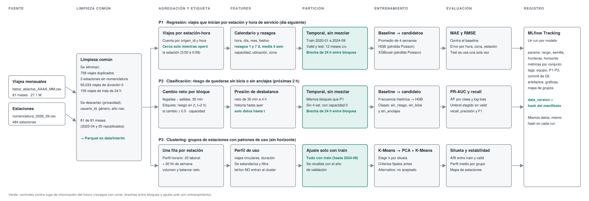

# Diseño del pipeline de ML — Proyecto MiBici (Equipo 7)

> **Estado:** borrador para acordar en el equipo. Las cifras salen del EDA (notebooks `0.01-fat`, `0.02-dsh` y `0.01-lasd`, y `definicion-datos.md`). Los umbrales y parámetros marcados como *propuesta* se fijarán con evidencia en el EDA.

## 1. Vista general

*Una limpieza común se bifurca en tres carriles, uno por pregunta. Cada carril recorre agregación, features, partición, entrenamiento y evaluación, y registra en MLflow con el mismo `data_version`. En verde, los controles contra fuga de información del futuro.* El diagrama de componentes y herramientas está en la sección *Arquitectura* del README ([`arquitectura.png`](arquitectura.png)).

El flujo sigue la convención de datos de CCDS (`raw` → `interim` → `processed`): cada etapa lee de una carpeta y escribe en la siguiente, y nunca se modifica lo que ya está en `raw`.

| Etapa | Entrada | Código (CCDS) | Salida |
|---|---|---|---|
| **1. Ingesta** | CSV del portal | `dataset.py` | `data/raw/` con los CSV originales y `manifest.json` (registros y SHA-256) |
| **2. Limpieza** | `data/raw/` | `dataset.py` | `data/interim/` con Parquet limpio (columnas, fechas y tipos normalizados) |
| **3. Agregación y features** | `data/interim/` | `features.py` | `data/processed/` con tablas de features por estación-hora y por estación |
| **4. Partición** | `data/processed/` | `features.py` | Conjuntos de entrenamiento, validación y prueba (temporal) |
| **5. Entrenamiento** | `data/processed/` | `modeling/train.py` | `models/` con los modelos serializados, un run de MLflow por pregunta |
| **6. Evaluación** | Modelos y conjuntos | `modeling/train.py`, `plots.py` | Métricas en MLflow y figuras en `reports/figures/` |
| **7. Predicción** | Modelo registrado y datos nuevos | `modeling/predict.py` | Predicciones por lotes |

**Trazabilidad:** cada run de MLflow guarda `data_version`, el hash del manifiesto, de modo que cualquier métrica se puede ligar a la versión exacta de los datos.

**Estado de los notebooks frente a CCDS:** los notebooks de P3 (`0.01-lasd` a `0.05-lasd`) ya usan `dataset.py`: leen el Parquet normalizado de `data/interim/` (que deja `make data`) y los datos de `data/processed/`. `0.02-dsh` guarda el Parquet en `data/interim/`. Solo `0.01-fat` sigue leyendo los Parquet mensuales de `data/external/`; al migrar su lógica a `dataset.py` también debe leer de `data/interim/`. `external` queda para datos de terceros que no pasan por la ingesta.

**Principios comunes**
- **Reproducibilidad:** semilla 42, dependencias con versiones fijadas y manifiesto de datos.
- **Sin fuga:** partición temporal y cortes de información definidos en `definicion-datos.md` (sección 5).
- **Cada decisión de limpieza se justifica con una cifra del EDA.**
- **Cada corrida** registra en MLflow parámetros, métricas, etiquetas (equipo, pregunta, commit) y artefactos.

## 2. Limpieza común a las tres preguntas

| Regla | Cifra del EDA | Tratamiento propuesto |
|---|---|---|
| Viajes duplicados | 758 filas repetidas completas | Eliminar, conservando una |
| Estaciones sin nomenclatura | 3 ids (124, 405, 407), 3,961 viajes (0.015 %) | Excluir: sin capacidad ni ubicación no se pueden usar en P2 ni P3 |
| Duración cero | 53,581 viajes (0.2 %) | Excluir de la demanda (probable desbloqueo fallido); medir sensibilidad |
| Duración extrema | 157 viajes de más de 24 h (máximo 469 h) | Excluir de las features de duración; no afectan conteos |
| Estaciones con capacidad 0 | 4 estaciones | Excluir de P2; revisar su papel en P1 y P3 |
| Meses sin datos | 2023-04 y 2023-05 | No imputar; marcar el hueco y no generar rezagos que crucen el hueco |
| Datos personales | `usuario_id`, `genero`, `anio_de_nacimiento` | Descartar al pasar a `processed` (minimización) |

## 3. P1: demanda de viajes (regresión)

Se predicen los viajes que inician en cada estación por hora de servicio (5:00 a 0:59) **para el día siguiente**: al cierre del día D se predicen las 20 horas de D+1. La zona (municipio: GDL, ZPN o TLQ) es la suma de sus estaciones. Código: `features.py` (funciones `p1_*` y `P1NivelEstacion`), `modeling/train.py` (sección P1) y `modeling/predict.py` (`p1_predecir`, `p1_predecir_por_zona`).

### Etapas

| Etapa | Descripción |
|---|---|
| **Limpieza** | La común del proyecto (`dataset.limpiar`); se descartan los 193 viajes en horas sin servicio (1:00 a 4:59) |
| **Agregación** | Contar viajes por `origen_id` y hora de `inicio_del_viaje`. Las horas sin viajes valen 0 **solo dentro del periodo en que la estación operó** (de su primer a su último viaje); antes y después quedan vacías, para no inventar demanda. Resultado: 16,103,922 estación-horas |
| **Features** | Ver tabla siguiente (`make features-p1`) |
| **Partición** | La común del proyecto, con una brecha de 24 h antes de cada frontera: train 10,531,227 filas, valid 2,673,888 y test 2,884,207 |
| **Entrenamiento** | Baseline, HistGradientBoosting Poisson y XGBoost Poisson, cada uno en un `Pipeline` (`make train-p1`) |
| **Evaluación** | MAE y RMSE en valid y test, MAE por hora, por zona y por estación, real contra predicción y serie diaria; se elige con valid |

### Variables

| Variable | Tipo | Por qué es pertinente |
|---|---|---|
| `hora`, `dia_semana`, `es_fin_de_semana`, `mes` | Calendario | El uso tiene ciclos diarios (picos de 8:00 y 18:00), semanales y estacionales |
| `es_festivo` | Calendario | La demanda cae o cambia de perfil en los días de descanso obligatorio (LFT art. 74) |
| `viajes_rezago_1d`, `viajes_rezago_7d` | Rezago | La misma hora de ayer y de la semana pasada es el mejor predictor de la demanda |
| `viajes_promedio_4sem` | Ventana (solo días anteriores) | Promedio de la misma hora en las 4 semanas previas: suaviza el ruido sin usar el futuro |
| `capacidad`, `latitud`, `longitud`, `zona` | Estación | Ubicación y tamaño explican parte del nivel de demanda |
| `dias_desde_apertura` | Estación | Una estación recién abierta todavía no alcanza su demanda estable |
| `origen_id` | Estación | Solo para aprender el nivel de cada estación (`P1NivelEstacion`, con train); no entra como variable al modelo |

**Restricción de horizonte:** todos los rezagos son de **1 día o más**, porque se predice el día siguiente.

### Modelos y métricas

| Rol | Modelo | Nota |
|---|---|---|
| Baseline | Promedio de la misma hora en las 4 semanas anteriores (si no hay historia, el nivel de la estación en train o el del sistema) | Es el piso que se debe superar |
| Candidato 1 | HistGradientBoosting con pérdida Poisson | Conteo con 44 % de ceros; nunca predice negativos; usa histogramas y maneja rezagos vacíos sin imputar |
| Candidato 2 | XGBoost con pérdida Poisson | Las mismas ventajas; compara dos implementaciones de boosting |

- **Métricas:** MAE (principal, en viajes por estación-hora), RMSE (penaliza los errores en los picos). Se evita MAPE porque el 44 % de las estación-horas tiene 0 viajes.
- **Hiperparámetros:** fijos en `config.py` para esta entrega (sin búsqueda); el modelo se elige con `valid_mae` y test solo se reporta. Resultado: XGBoost (`valid_mae` 0.9761, `test_mae` 0.9952), 4.2 % mejor que el baseline en valid.

## 4. P2: riesgo de quedarse sin bicis o sin anclajes (clasificación)

### Etapas

| Etapa | Descripción |
|---|---|
| **Agregación** | Por estación y hora: salidas (`origen_id`, `inicio_del_viaje`) y llegadas (`destino_id`, `fin_del_viaje`); `neto = llegadas − salidas`, acumulado desde el inicio del día |
| **Etiqueta** | En el instante `t`, riesgo en `(t, t+2h]` si el acumulado alcanza `±u·capacidad`. Tres clases: normal, sin bicis y sin anclajes |
| **Features** | Ver tabla siguiente; todas calculadas con información hasta `t` |
| **Partición** | Temporal con brecha de 2 h entre conjuntos |
| **Entrenamiento** | Regla simple → regresión logística → XGBoost con pesos de clase |
| **Evaluación** | Métricas para clase minoritaria, umbral de decisión elegido en validación y análisis por estación |

### Variables

| Variable | Por qué es pertinente |
|---|---|
| `neto_acumulado_dia` | Estado actual aproximado de la estación respecto al inicio del día |
| `neto_1h`, `neto_2h`, `neto_3h` | Tendencia reciente: una estación que se vacía a ritmo constante llegará a cero |
| `neto_sobre_capacidad` | Normaliza por tamaño: −5 bicis es grave en una estación de 15 y no en una de 39 |
| `salidas_1h`, `llegadas_1h` | Distingue una estación muy activa de una con movimiento equilibrado |
| `hora`, `dia_semana`, `es_festivo` | Los picos de desbalance siguen la hora y el tipo de día |
| `neto_misma_hora_semana_anterior` | Patrón repetitivo de desbalance por estación |
| `capacidad` | Define cuántas bicis o anclajes son críticos |
| `demanda_esperada_2h` (opcional) | Salida de P1: encadena ambos modelos |

### Modelos y métricas

| Rol | Modelo | Nota |
|---|---|---|
| Baseline | Regla: `neto_sobre_capacidad` supera un umbral | Lo que haría un operador sin ML |
| Candidato 1 | Regresión logística con pesos de clase | Interpretable |
| Candidato 2 | XGBoost con pesos de clase | Interacciones hora × estación |

- **Desbalance:** el riesgo es un evento raro. Se usan pesos de clase y se evita *accuracy*.
- **Métricas:** PR-AUC (principal), recall y precisión de la clase de riesgo, F1 y matriz de confusión.
- **Umbral:** se elige en validación según el costo operativo: perder una estación en riesgo cuesta más que una alerta falsa, así que se prioriza el recall con una precisión mínima acordada.

### Limitación declarada

No hay inventario de bicicletas, por lo que la etiqueta es un **proxy**: el acumulado parte de un nivel desconocido y no ve el rebalanceo realizado. El modelo detecta **presión de desbalance**, no el inventario real. Debe validarse con el equipo de operación antes de usarse.

## 5. P3: grupos de estaciones (clustering)

### Etapas

| Etapa | Descripción |
|---|---|
| **Agregación** | Una fila por estación, calculada **solo con el periodo de entrenamiento** |
| **Features** | Ver tabla siguiente |
| **Preparación** | Filtrar estaciones con pocos viajes, estandarizar y, si hace falta, reducir con PCA |
| **Entrenamiento** | K-Means (baseline) y HDBSCAN o clustering jerárquico como alternativa |
| **Evaluación** | Silueta, estabilidad en el tiempo e interpretación de cada grupo |

### Variables

| Variable | Por qué es pertinente |
|---|---|
| `perfil_horario_laboral` (24 valores, normalizado) | Distingue estaciones de commuting (picos de mañana y tarde) de las de ocio |
| `perfil_horario_fin_de_semana` (24 valores) | Revela uso recreativo |
| `viajes_diarios_medios` (en logaritmo) | Separa estaciones de alto y bajo volumen |
| `razon_salidas_llegadas` | Estaciones que son origen neto o destino neto |
| `desbalance_hora_pico` | Estaciones que se vacían o se llenan siempre a la misma hora |
| `proporcion_viajes_circulares` | Origen = destino, típico de uso recreativo |
| `duracion_mediana_salida` | Viajes cortos de conexión frente a recorridos largos |
| `latitud`, `longitud` | **No entran al clustering**; se usan después para ubicar y describir cada grupo |

### Evaluación

| Criterio | Cómo se mide |
|---|---|
| **Cohesión y separación** | Coeficiente de silueta e índice de Davies-Bouldin para varios valores de `k` |
| **Estabilidad** | Índice de Rand ajustado entre los grupos del entrenamiento y los recalculados con el año de validación |
| **Interpretabilidad** | Perfil horario medio por grupo y mapa de estaciones; cada grupo debe poder nombrarse (por ejemplo, "oficinas") |

El criterio decisivo es la **utilidad para planeación urbana**, no solo la métrica: un `k` con silueta ligeramente menor pero grupos interpretables es preferible.

## 6. Comparación entre preguntas

| | P1 | P2 | P3 |
|---|---|---|---|
| **Unidad de análisis** | Estación-hora | Estación-hora | Estación |
| **Objetivo** | Conteo de viajes | Clase de riesgo | Sin objetivo |
| **Baseline** | Media por estación-hora-día | Regla por umbral | K-Means |
| **Modelo candidato** | XGBoost (Poisson) | XGBoost con pesos | HDBSCAN |
| **Métrica principal** | MAE | PR-AUC | Silueta + estabilidad |
| **Riesgo principal** | Fuga por rezagos | Proxy sin inventario | Grupos no interpretables |

## 7. Pendientes del equipo

- Valor del umbral `u` del riesgo en P2 y la ventana de acumulación (inicio del día u otra).
- Tratamiento de los 53,581 viajes con duración cero (excluir o conservar) y su sensibilidad.
- Número de estaciones mínimo de viajes para entrar a P3.
- Qué modelos candidatos se implementan primero dado el tiempo disponible.
